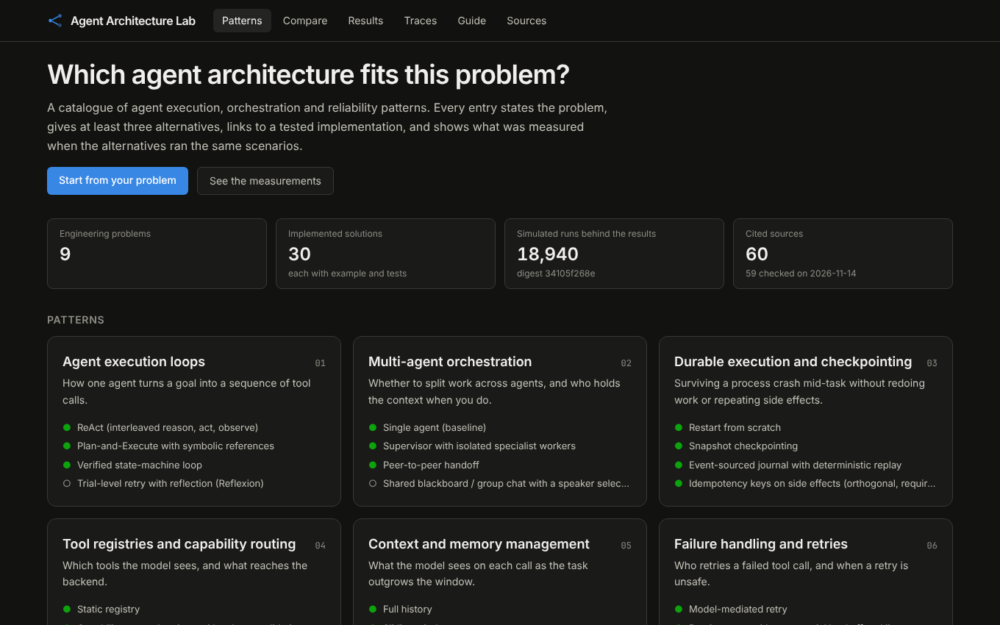
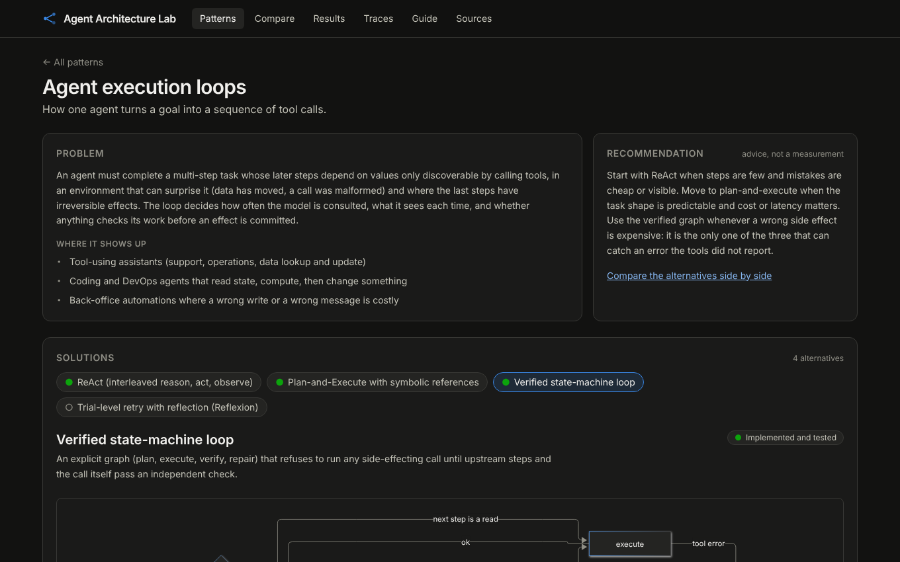
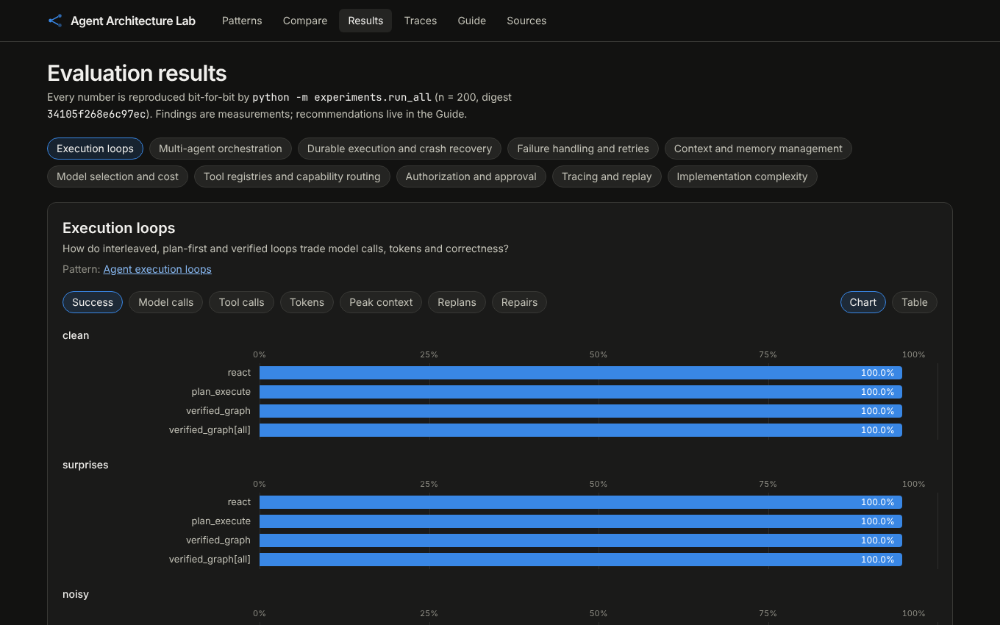
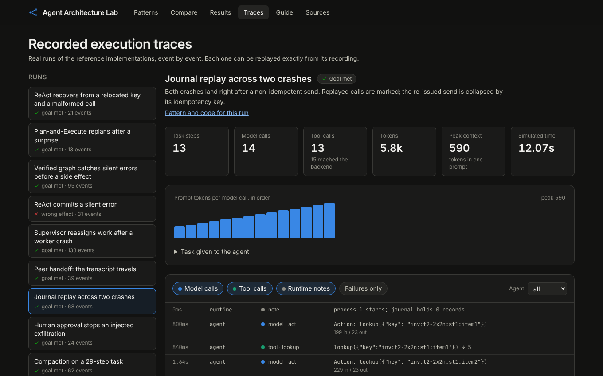

# Explorer

A static, dark-mode web interface for the catalogue. It contains **no agent logic**: it only renders JSON that `scripts/build_catalog.py` generates into `public/data/` from the pattern definitions, the experiment results and recorded traces.

| View | What it answers |
|---|---|
| Patterns | What are the alternatives for this problem? Diagram, trade-offs, runnable code. |
| Compare | How do the alternatives differ, attribute by attribute and metric by metric? |
| Results | What was measured, under which conditions, with which limitations? |
| Traces | What did a real run do, event by event? |
| Guide | I have problem X: what should I use and what is the evidence? |
| Sources | Where does each research claim come from, and was it checked? |



| Pattern detail | Results | Trace viewer |
|---|---|---|
|  |  |  |

## Run it

1. Install dependencies.

```bash
npm install
```

2. Start the development server.

```bash
npm run dev
```

3. Or build a static site into `dist/` (relative asset paths, so it can be served from any directory).

```bash
npm run build
```

## Verify it

Type-check and build:

```bash
npm run build
```

Browser smoke test (visits every route and every solution, fails on console errors, failed requests, unrendered diagrams or horizontal overflow). Requires Playwright to be resolvable (`npm install --no-save playwright && npx playwright install chromium` if it is not installed globally):

```bash
npm run smoke
```

## Refreshing the data

The files under `public/data/` are generated and committed. After changing a pattern, an experiment or the library:

```bash
python scripts/build_catalog.py
```

(run from the repository root).

## Stack and conventions

React 19, TypeScript (strict), Tailwind CSS 4, Vite. No router or state library: a 30-line hash router and `fetch`. Mermaid renders the diagrams and is loaded on demand; highlight.js core with four languages colours the code.

Charts follow a few fixed rules: one measure and one axis per chart, a single series colour because rows are identified by their labels, value labels in text colour, a hover tooltip and a table view for every chart. Chart colours are the dark steps of a palette validated for colour-vision-deficiency separation and contrast against the chart surface (`#1a1a19`). Status is always an icon plus words, never colour alone.
