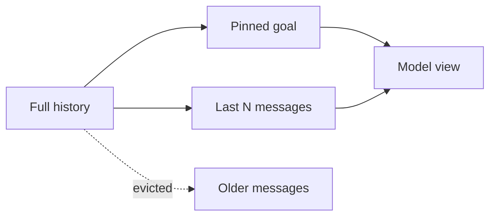
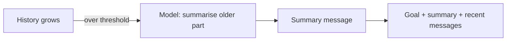
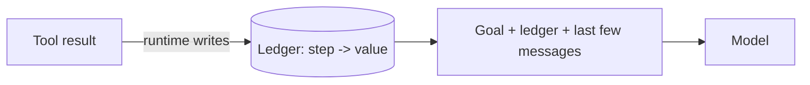

<!-- Generated by scripts/build_catalog.py. Edit patterns/context-memory/pattern.toml instead. -->

# Context and memory management

> What the model sees on each call as the task outgrows the window.

## Problem

An agent's transcript grows with every step, each model call re-reads it, and both cost and error rate rise with length. Dropping history saves tokens but the agent may then need a value it no longer has, or lose track of what it has already done. The policy decides what stays visible, what is condensed and what is kept outside the context.

**Practical applications**

- Long-running agents (dozens to hundreds of tool calls)
- Chat agents with long sessions
- Any loop where input tokens dominate cost

## Recommendation

_This section is advice. The evidence behind it is under [Measured comparison](#measured-comparison)._

Use full history until it hurts. Prefer a structured ledger when tool outputs are structured, because it costs no model calls and loses nothing you chose to keep. Use compaction for free-text histories. Treat a bare sliding window as a last resort: if a dependency reaches further back than the window, the agent pays to re-derive it or stalls.

## Solutions at a glance

| Solution | Status | Implementation | Example | Tests |
|---|---|---|---|---|
| [Full history](#full-history) | implemented | [`src/agentlab/memory/context.py`](../../src/agentlab/memory/context.py) | [`examples/09_context_memory.py`](../../examples/09_context_memory.py) | [`tests/test_memory.py`](../../tests/test_memory.py) |
| [Sliding window](#sliding-window) | implemented | [`src/agentlab/memory/context.py`](../../src/agentlab/memory/context.py) | [`examples/09_context_memory.py`](../../examples/09_context_memory.py) | [`tests/test_memory.py`](../../tests/test_memory.py) |
| [Compaction (summarise and continue)](#compaction-summarise-and-continue) | implemented | [`src/agentlab/memory/context.py`](../../src/agentlab/memory/context.py) | [`examples/09_context_memory.py`](../../examples/09_context_memory.py) | [`tests/test_memory.py`](../../tests/test_memory.py) |
| [Structured fact ledger](#structured-fact-ledger) | implemented | [`src/agentlab/memory/context.py`](../../src/agentlab/memory/context.py) | [`examples/09_context_memory.py`](../../examples/09_context_memory.py) | [`tests/test_memory.py`](../../tests/test_memory.py) |

## Full history

**Status:** implemented

Send everything every time.

**Advantages**

- Nothing is ever forgotten
- Stable prefix: ideal for prompt caching on real APIs

**Limitations**

- Quadratic total tokens
- Eventually exceeds the window
- Long contexts degrade recall in real models

**Performance.** Measured: 7.3k tokens at 15 steps, 82.9k at 57; peak context 2,271.

**Complexity.** None.

**Reliability.** No forgetting failures.

**Security.** Untrusted content, once read, stays in context for the rest of the run.

**Use when**

- Short and medium tasks
- Prompt caching makes re-reading cheap

**Avoid when**

- Runs that approach the context window

**Where you have seen it.** Default everywhere.

## Sliding window

**Status:** implemented

Keep the goal and the last N messages.



**Advantages**

- Hard bound on context size
- No extra model calls

**Limitations**

- Evicted values must be re-fetched, which costs model calls
- If a dependency spans more than the window the agent can livelock
- Evicting side-effect records risks repeating them

**Performance.** Measured at 57 steps: window-16 used 79.7k tokens and 97 tool calls; window-32 101.7k tokens; full history 82.9k tokens and 57 tool calls.

**Complexity.** A slice.

**Reliability.** Measured: window-6 completed 0% of tasks at every length (it ran to the iteration cap); window-16 completed 100%.

**Security.** Evicts untrusted content along with everything else.

**Use when**

- Chat-like interactions where old turns truly stop mattering

**Avoid when**

- Tasks with long-range dependencies
- Tasks with non-idempotent effects

**Where you have seen it.** LangChain message trimming; OpenAI Agents SDK session history limits.

## Compaction (summarise and continue)

**Status:** implemented

When the context passes a threshold, replace older messages with a model-written summary and keep the most recent ones verbatim.



**Advantages**

- Bounds context without re-fetching
- Works on free-text histories

**Limitations**

- Extra model calls to summarise
- Summaries lose detail in ways that are hard to predict
- Rewrites the prefix, which invalidates prompt caches

**Performance.** Measured at 57 steps: 55.4k tokens, peak context 1,128, 61 model calls (full history: 58).

**Complexity.** A threshold, a cut point and a summarise call.

**Reliability.** 100% success here with a lossless simulated summariser; real summarisers will do worse.

**Security.** A summary is model output derived from possibly untrusted text: it can carry an injection forward in condensed form.

**Use when**

- Long conversational or free-text runs
- No structured state to fall back on

**Avoid when**

- Exact values from early steps are needed later and are not in a ledger

**Integration**

```python
from agentlab.memory.context import Compaction
ReActLoop(rt, memory=Compaction(max_tokens=600, keep_recent=4)).run(goal)
```
The model must answer a `summarize` request.

**Where you have seen it.** Claude API server-side compaction; Claude Code auto-compact; LangGraph summarisation nodes.

## Structured fact ledger

**Status:** implemented

The runtime copies each tool result into a keyed ledger outside the transcript and shows the model the ledger plus the last few messages.



**Advantages**

- No model calls
- Exact values are preserved
- Smallest context

**Limitations**

- Needs structured tool outputs or a note-taking tool
- Reasoning that was only in prose is gone

**Performance.** Measured at 57 steps: 40.3k tokens, peak context 777, no additional model calls.

**Complexity.** A dictionary updated per tool result.

**Reliability.** 100% success at every length tested.

**Security.** Only values enter the ledger; free-text notes attached to tool output do not persist.

**Use when**

- Tool outputs are structured
- The task is a pipeline of values

**Avoid when**

- The valuable content is unstructured reasoning

**Integration**

```python
from agentlab.memory.context import FactLedger
ReActLoop(rt, memory=FactLedger(keep_recent=2)).run(goal)
```

**Where you have seen it.** LangGraph state channels; structured note-taking and memory tools; plan variables in ReWOO.

## Measured comparison

From [`experiments/results/memory.json`](../../experiments/results/memory.json), produced by `python -m experiments.run_all`. **Question:** How should an agent bound its context as a task grows, and what breaks when it forgets?

**15 steps**

| Policy | Success | Tokens | Peak context | Model calls | Tool calls | Duplicate effects |
|---|---:|---:|---:|---:|---:|---:|
| full | 100.0% | 7,347 | 665 | 16.00 | 15.00 | 0.00 |
| window-6 | 0.0% | 20,354 | 322 | 60.00 | 60.00 | 0.00 |
| window-16 | 100.0% | 6,519 | 459 | 16.00 | 15.00 | 0.00 |
| window-32 | 100.0% | 7,347 | 665 | 16.00 | 15.00 | 0.00 |
| compaction-600 | 100.0% | 7,347 | 665 | 16.00 | 15.00 | 0.00 |
| ledger | 100.0% | 4,692 | 304 | 16.00 | 15.00 | 0.00 |

**29 steps**

| Policy | Success | Tokens | Peak context | Model calls | Tool calls | Duplicate effects |
|---|---:|---:|---:|---:|---:|---:|
| full | 100.0% | 23,457 | 1,200 | 30.00 | 29.00 | 0.00 |
| window-6 | 0.0% | 52,206 | 431 | 116 | 116 | 0.00 |
| window-16 | 100.0% | 29,104 | 604 | 50.00 | 49.00 | 0.00 |
| window-32 | 100.0% | 38,649 | 877 | 50.00 | 49.00 | 0.00 |
| compaction-600 | 100.0% | 19,513 | 900 | 31.00 | 29.00 | 0.00 |
| ledger | 100.0% | 12,834 | 462 | 30.00 | 29.00 | 0.00 |

**57 steps**

| Policy | Success | Tokens | Peak context | Model calls | Tool calls | Duplicate effects |
|---|---:|---:|---:|---:|---:|---:|
| full | 100.0% | 82,950 | 2,271 | 58.00 | 57.00 | 0.00 |
| window-6 | 0.0% | 152,674 | 649 | 228 | 228 | 0.00 |
| window-16 | 100.0% | 79,700 | 823 | 98.00 | 97.00 | 0.00 |
| window-32 | 100.0% | 101,697 | 1,097 | 98.00 | 97.00 | 0.00 |
| compaction-600 | 100.0% | 55,399 | 1,128 | 61.00 | 57.00 | 0.00 |
| ledger | 100.0% | 40,339 | 777 | 58.00 | 57.00 | 0.00 |

**Measured findings**

- Full history grows quadratically: 7347 tokens at 15 steps, 82950 at 57 (peak context 2271).
- A 6-message window succeeds on 0% / 0% / 0% of tasks: it livelocks, re-fetching one evicted operand while the other falls out of the window (60 tool calls until the iteration cap vs 15 needed).
- A window large enough to finish is not automatically cheaper: at 57 steps window-16 uses -4% tokens vs full history and window-32 +23%, because re-fetching adds model calls.
- A 16-message window succeeds on 100% / 100% / 100%; a 32-message window on 100% / 100% / 100%, using 97.0 tool calls at 57 steps (vs 57.0 needed).
- Compaction keeps 57-step tasks at 100% success with -33% tokens vs full history, paying 3.0 extra (summarisation) model calls.
- The fact ledger is cheapest: -51% tokens at 57 steps, peak context 777, no extra model calls.

**Limitations of this experiment**

- The simulated summariser is lossless for task facts. Real summaries drop or distort details; treat the compaction numbers as an upper bound.
- The simulated model has no recall degradation with context length ('context rot'), so full history is never penalised for size, only charged for it.
- The ledger needs structured tool outputs keyed by step; free-text observations require a model call to extract facts.

## Research

- Anthropic (2025). [Effective context engineering for AI agents](https://www.anthropic.com/engineering/effective-context-engineering-for-ai-agents).
- Chroma Research (2025). [Context Rot: How Increasing Input Tokens Impacts LLM Performance](https://research.trychroma.com/context-rot).
- Charles Packer et al. (7 authors) (2023). [MemGPT: Towards LLMs as Operating Systems](https://arxiv.org/abs/2310.08560).
- Joon Sung Park et al. (6 authors) (2023). [Generative Agents: Interactive Simulacra of Human Behavior](https://arxiv.org/abs/2304.03442).
