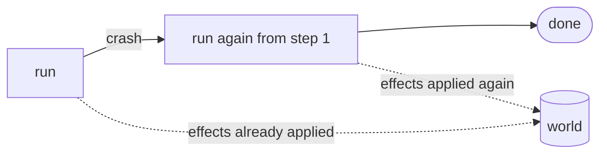
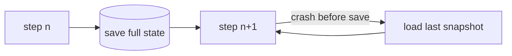
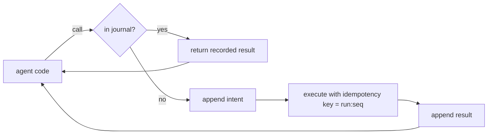

<!-- Generated by scripts/build_catalog.py. Edit patterns/durable-execution/pattern.toml instead. -->

# Durable execution and checkpointing

> Surviving a process crash mid-task without redoing work or repeating side effects.

## Problem

Agent runs last minutes to hours and call external systems. The process will be restarted mid-run by deploys, crashes and timeouts. Recovery must not lose completed work (re-issuing model calls costs money) and must not repeat a side effect that already happened. The hard case is a crash after a tool applied its effect but before the agent recorded the result.

**Practical applications**

- Long-running agents on preemptible or autoscaled infrastructure
- Runs that pause for human approval for hours
- Any agent that sends messages, moves money or mutates records

## Recommendation

_This section is advice. The evidence behind it is under [Measured comparison](#measured-comparison)._

If steps are cheap and idempotent, restarting is fine. Otherwise persist progress: use snapshots when your loop already has an explicit state object (graphs), and a journal when you want durability without touching loop code. In both cases add idempotency keys to every non-idempotent tool; nothing else closes the crash-after-effect window.

## Solutions at a glance

| Solution | Status | Implementation | Example | Tests |
|---|---|---|---|---|
| [Restart from scratch](#restart-from-scratch) | implemented | [`src/agentlab/durability/crash.py`](../../src/agentlab/durability/crash.py) | [`examples/07_durable_execution.py`](../../examples/07_durable_execution.py) | [`tests/test_durability.py`](../../tests/test_durability.py) |
| [Snapshot checkpointing](#snapshot-checkpointing) | implemented | [`src/agentlab/durability/stores.py`](../../src/agentlab/durability/stores.py) | [`examples/06_state_graph.py`](../../examples/06_state_graph.py) | [`tests/test_durability.py`](../../tests/test_durability.py) |
| [Event-sourced journal with deterministic replay](#event-sourced-journal-with-deterministic-replay) | implemented | [`src/agentlab/durability/journal.py`](../../src/agentlab/durability/journal.py) | [`examples/07_durable_execution.py`](../../examples/07_durable_execution.py) | [`tests/test_durability.py`](../../tests/test_durability.py) |
| [Idempotency keys on side effects (orthogonal, required)](#idempotency-keys-on-side-effects-orthogonal-required) | implemented | [`src/agentlab/recovery/policies.py`](../../src/agentlab/recovery/policies.py) | [`examples/10_failure_recovery.py`](../../examples/10_failure_recovery.py) | [`tests/test_recovery.py`](../../tests/test_recovery.py) |

## Restart from scratch

**Status:** implemented

Persist nothing. After a crash, run the task again.



**Advantages**

- Zero infrastructure
- Correct for pure, idempotent, cheap tasks

**Limitations**

- Repeats every model call and every tool call
- Repeats every non-idempotent effect that happened before the crash

**Performance.** Measured: 7.0 re-issued model calls per crash.

**Complexity.** None.

**Reliability.** Measured over every crash point: 35% correct completion, 0.96 duplicated effects per run.

**Security.** No state at rest.

**Use when**

- Read-only or fully idempotent tasks that are cheap to repeat

**Avoid when**

- Anything with non-idempotent side effects
- Expensive runs

**Where you have seen it.** Default behaviour of any loop without persistence.

## Snapshot checkpointing

**Status:** implemented

After each step (or graph node) write the whole state under a thread id; on restart load the latest snapshot and continue.



**Advantages**

- Simple mental model: state is a value
- Snapshots double as a time-travel and human-in-the-loop mechanism
- No determinism requirement on the code between snapshots

**Limitations**

- The loop must expose its state (a hook or an explicit state object)
- Writes the whole growing state every time
- The step in flight at the crash is re-executed: at-least-once

**Performance.** Measured store writes per run: 49.0k bytes for per-iteration snapshots, 240.6k bytes for per-node graph checkpoints, versus 9.4k for the journal.

**Complexity.** A store (47 SLOC shared with the journal) plus a hook in each loop.

**Reliability.** Measured over every crash point: 88% without idempotency keys, 100% with them. The failures are exactly the crashes right after a non-idempotent call.

**Security.** Snapshots contain the full transcript, including tool outputs: encrypt at rest and apply the same access control as the data sources.

**Use when**

- The loop is already a state graph
- You also want pause/resume and time travel

**Avoid when**

- State is large and steps are frequent
- You cannot modify the loop

**Integration**

```python
from agentlab.durability.stores import SQLiteCheckpointer
store = SQLiteCheckpointer("runs.sqlite")
saved = store.latest(thread_id)
loop = ReActLoop(rt, on_step=lambda history: store.put(thread_id, {"history": history}))
loop.run(goal, resume=saved["history"] if saved else None)
```
Graph loops take `checkpointer=` directly and resume with `loop.resume()`.

**Where you have seen it.** LangGraph checkpointers; CrewAI Flow state persistence; OpenAI Agents SDK sessions (history only).

## Event-sourced journal with deterministic replay

**Status:** implemented

Record every model response and tool result in an append-only journal. After a crash re-run the same code; recorded results are returned without touching the model or the world.



**Advantages**

- Wraps any loop without changing it
- Completed model calls are never re-issued
- Append-only writes proportional to new information
- The journal is a complete audit trail

**Limitations**

- Agent code must be deterministic given recorded results; a code change mid-run can diverge
- Recovery time grows with journal length
- Still at-least-once for the call in flight unless the backend honours idempotency keys

**Performance.** Measured: 0.00 re-issued model calls per crash (snapshot: 1.00).

**Complexity.** 60 SLOC of wrappers.

**Reliability.** Measured over every crash point: 88% without idempotency keys, 100% with them; 100% with two crashes in one run. Divergent code is detected and refused, not silently accepted.

**Security.** The journal stores every model output and tool result; same handling as snapshots.

**Use when**

- You want durability as a wrapper
- Model calls are the expensive part
- You need an audit trail

**Avoid when**

- The loop is non-deterministic in ways you cannot record (wall-clock branches, unrecorded randomness)

**Integration**

```python
from agentlab.durability.journal import DurableSession
from agentlab.durability.stores import SQLiteJournal
session = DurableSession(SQLiteJournal("journal.sqlite"), run_id="run-42")
rt = Runtime(session.model(model), session.tools(tools))
ReActLoop(rt).run(goal)      # run the same line again after a crash
```

**Where you have seen it.** Temporal, Restate, DBOS, Azure Durable Functions. LangGraph's functional API tasks are the closest analogue inside an agent framework.

## Idempotency keys on side effects (orthogonal, required)

**Status:** implemented

Give every side-effecting call a key derived from the logical operation, so the backend applies it at most once however many times it is sent.

**Advantages**

- Turns at-least-once delivery into effectively-once effects
- Works with every persistence strategy and with retries

**Limitations**

- The backend must support it
- The key must identify the operation, not the attempt

**Reliability.** Measured over every crash point: snapshots went from 88% to 100% correct completion, graph checkpoints from 88% to 100%, the journal from 88% to 100%. With two crashes in one run: 100% and 100%.

**Security.** Derive keys from the run and the logical step, not from user-controlled text, so one caller cannot suppress another's operation.

**Use when**

- Always, for non-idempotent tools

**Avoid when**

- Never; if the backend has no keys, add a read-back check before retrying

**Where you have seen it.** Stripe-style Idempotency-Key headers; Temporal activity ids.

## Measured comparison

From [`experiments/results/durability.json`](../../experiments/results/durability.json), produced by `python -m experiments.run_all`. **Question:** After a process crash at any point, which persistence strategy finishes the task without repeating side effects, and at what cost?

**single crash (exhaustive)**

| Strategy | Runs | Correct completion | Duplicate effects | Re-issued model calls | Re-executed tool calls | Store bytes | Store writes |
|---|---:|---:|---:|---:|---:|---:|---:|
| restart | 520 | 34.6% | 0.96 | 7.00 | 6.50 | 0.00 | 0.00 |
| snapshot | 520 | 88.5% | 0.12 | 1.00 | 0.50 | 48,963 | 13.00 |
| snapshot+idem | 520 | 100.0% | 0.00 | 1.00 | 0.50 | 48,963 | 13.00 |
| graph_checkpoint | 520 | 88.5% | 0.12 | 0.00 | 0.50 | 240,621 | 35.00 |
| graph_checkpoint+idem | 520 | 100.0% | 0.00 | 0.00 | 0.50 | 240,621 | 35.00 |
| journal | 520 | 88.5% | 0.12 | 0.00 | 0.50 | 9,374 | 40.00 |
| journal+idem | 520 | 100.0% | 0.00 | 0.00 | 0.50 | 9,374 | 40.00 |

**two crashes (sampled)**

| Strategy | Runs | Correct completion | Duplicate effects | Re-issued model calls | Re-executed tool calls | Store bytes | Store writes |
|---|---:|---:|---:|---:|---:|---:|---:|
| restart | 200 | 13.0% | 2.09 | 14.26 | 13.73 | 0.00 | 0.00 |
| snapshot | 200 | 69.5% | 0.33 | 1.48 | 1.22 | 48,963 | 13.00 |
| snapshot+idem | 200 | 100.0% | 0.00 | 1.48 | 1.22 | 48,963 | 13.00 |
| graph_checkpoint | 200 | 69.5% | 0.33 | 0.00 | 1.22 | 240,621 | 35.00 |
| graph_checkpoint+idem | 200 | 100.0% | 0.00 | 0.00 | 1.22 | 240,621 | 35.00 |
| journal | 200 | 69.5% | 0.33 | 0.00 | 1.22 | 9,374 | 40.00 |
| journal+idem | 200 | 100.0% | 0.00 | 0.00 | 1.22 | 9,373 | 40.00 |

**Measured findings**

- Restart-from-scratch completes 35% of crashed runs correctly; every failure is a duplicated notification (0.96 duplicates per run) and it re-issues 7.0 model calls on average.
- Snapshots and the journal both stop at 88% / 88% without idempotency keys: the failures are exactly the crashes that land between a non-idempotent effect and its record.
- Adding idempotency keys closes that window for every strategy that persists progress: snapshot+idem 100%, graph_checkpoint+idem 100%, journal+idem 100%.
- Recovery cost in re-issued model calls: journal 0.00, snapshot 1.00, graph checkpoint 0.00, restart 7.00.
- Bytes written to the durable store per run: journal 9374, per-iteration snapshot 48963, per-node graph checkpoint 240621 (snapshots rewrite the whole growing state each time).

**Limitations of this experiment**

- Crashes are injected only around tool calls, not inside model calls or store writes; torn writes are delegated to SQLite transactions.
- The backend honours idempotency keys perfectly and forever. Real APIs expire keys and some offer none.
- The journal relies on the agent code being deterministic; that holds here by construction and must be enforced in real code.

## Research

- LangChain (2026). [LangGraph persistence (checkpointers and stores)](https://docs.langchain.com/oss/python/langgraph/persistence).
- LangChain (2026). [LangGraph interrupts](https://docs.langchain.com/oss/python/langgraph/interrupts).
- Temporal Technologies (2026). [Temporal: Workflow Execution](https://docs.temporal.io/workflow-execution).
- Restate (2026). [Restate documentation](https://docs.restate.dev/).
- DBOS (2026). [DBOS documentation](https://docs.dbos.dev/).
- Stripe (Brandur Leach) (2017). [Designing robust and predictable APIs with idempotency](https://stripe.com/blog/idempotency).
- Hector Garcia-Molina and Kenneth Salem, SIGMOD (1987). [Sagas](https://dl.acm.org/doi/10.1145/38713.38742).
