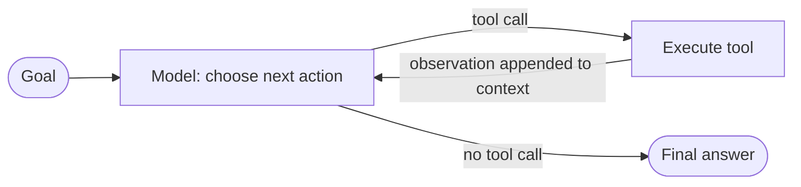
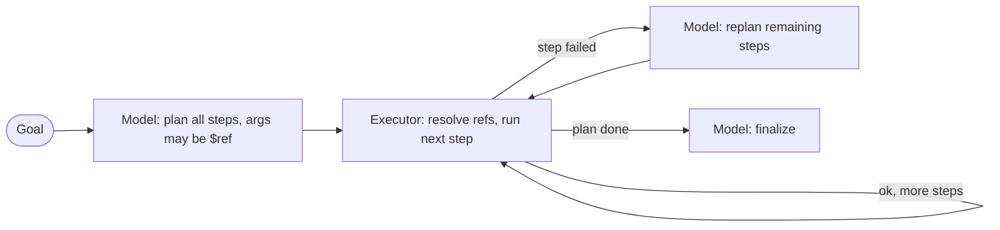
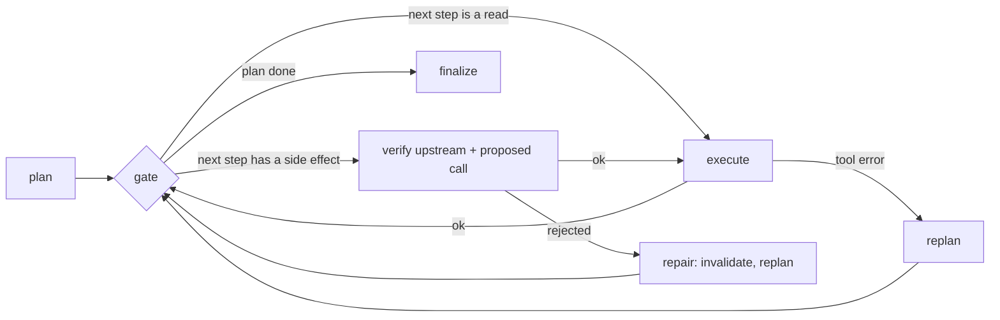

<!-- Generated by scripts/build_catalog.py. Edit patterns/execution-loops/pattern.toml instead. -->

# Agent execution loops

> How one agent turns a goal into a sequence of tool calls.

## Problem

An agent must complete a multi-step task whose later steps depend on values only discoverable by calling tools, in an environment that can surprise it (data has moved, a call was malformed) and where the last steps have irreversible effects. The loop decides how often the model is consulted, what it sees each time, and whether anything checks its work before an effect is committed.

**Practical applications**

- Tool-using assistants (support, operations, data lookup and update)
- Coding and DevOps agents that read state, compute, then change something
- Back-office automations where a wrong write or a wrong message is costly

## Recommendation

_This section is advice. The evidence behind it is under [Measured comparison](#measured-comparison)._

Start with ReAct when steps are few and mistakes are cheap or visible. Move to plan-and-execute when the task shape is predictable and cost or latency matters. Use the verified graph whenever a wrong side effect is expensive: it is the only one of the three that can catch an error the tools did not report.

## Solutions at a glance

| Solution | Status | Implementation | Example | Tests |
|---|---|---|---|---|
| [ReAct (interleaved reason, act, observe)](#react-interleaved-reason-act-observe) | implemented | [`src/agentlab/loops/react.py`](../../src/agentlab/loops/react.py) | [`examples/01_react_loop.py`](../../examples/01_react_loop.py) | [`tests/test_loops.py`](../../tests/test_loops.py) |
| [Plan-and-Execute with symbolic references](#plan-and-execute-with-symbolic-references) | implemented | [`src/agentlab/loops/plan_execute.py`](../../src/agentlab/loops/plan_execute.py) | [`examples/02_plan_execute.py`](../../examples/02_plan_execute.py) | [`tests/test_loops.py`](../../tests/test_loops.py) |
| [Verified state-machine loop](#verified-state-machine-loop) | implemented | [`src/agentlab/loops/verified_graph.py`](../../src/agentlab/loops/verified_graph.py) | [`examples/03_verified_state_machine.py`](../../examples/03_verified_state_machine.py) | [`tests/test_loops.py`](../../tests/test_loops.py) |
| [Trial-level retry with reflection (Reflexion)](#trial-level-retry-with-reflection-reflexion) | documented | - | - | - |

## ReAct (interleaved reason, act, observe)

**Status:** implemented

One model call per tool call. The model sees every observation before choosing the next action.



**Advantages**

- Adapts to surprises for free: an error is just the next observation
- Smallest implementation; no plan format to design or parse
- Works with any tool-calling model API as-is

**Limitations**

- One model call per step over a growing transcript: total tokens grow quadratically with task length
- Nothing checks a call that succeeds with the wrong meaning; silent errors flow straight into side effects
- No global view: cannot reorder or parallelise steps

**Performance.** Model calls = steps + 1 (plus one per recoverable error). Measured: 16 calls and about 7.4k tokens for a 15-step task; about 25.2k tokens at 29 steps.

**Complexity.** Lowest. 57 SLOC, 12 branch points.

**Reliability.** Recovers from every error a tool reports. Blind to errors a tool does not report. Needs an iteration cap to bound loops.

**Security.** The model reads all tool output and decides the next call, so injected text in an observation can steer it directly. Pair with argument-level authorization.

**Use when**

- Short tasks, exploratory tasks, or unknown task shape
- Errors are loud (tools validate) or cheap
- You need the simplest thing that works

**Avoid when**

- Long tasks where token cost matters
- Side effects are irreversible and nothing else verifies them

**Integration**

```python
from agentlab.core.runtime import Runtime
from agentlab.loops.react import ReActLoop

rt = Runtime(model, tools)                 # any Model + any ToolExecutor
result = ReActLoop(rt, memory=policy, max_iters=80, on_step=checkpoint).run(goal_message)
```
`memory` bounds the context (see context-memory), `on_step` is the snapshot hook (see durable-execution). To run on a real model use `agentlab.integrations.anthropic_model.AnthropicModel`.

**Where you have seen it.** LangGraph prebuilt ReAct agent; OpenAI Agents SDK runner loop; CrewAI agent executor; any manual tool-use loop.

## Plan-and-Execute with symbolic references

**Status:** implemented

One call writes the whole plan with placeholders for values not yet known; code executes it and calls the model again only when a step fails.



**Advantages**

- Model calls are constant in task length when nothing goes wrong (plan + finalize)
- Intermediate values never enter the model's context; they are passed by reference
- The plan is an inspectable artefact: it can be reviewed, approved or parallelised before anything runs

**Limitations**

- Every surprise costs a full replan call over the whole transcript
- Needs a plan representation with references, and a model that can produce it reliably
- As blind to silent errors as ReAct

**Performance.** Measured: 2 model calls and about 995 tokens on a clean 15-step task, against 7.4k for ReAct. With two surprises: 4 calls, about 3.0k tokens.

**Complexity.** Low. 47 SLOC; the complexity moves into the plan format.

**Reliability.** Identical task success to ReAct under identical model errors (measured). Bounded by a replan budget.

**Security.** Plan-then-execute fixes the control flow before untrusted tool output is read, which is the property data-flow defences such as CaMeL build on. Replanning re-opens that door.

**Use when**

- Task shape is predictable
- Cost or latency dominates
- A human or policy should review the plan before execution

**Avoid when**

- Highly exploratory tasks where each observation changes what to do next
- Environments with frequent surprises

**Integration**

```python
from agentlab.loops.plan_execute import PlanExecuteLoop
result = PlanExecuteLoop(rt, max_replans=12).run(goal_message)
```
The model must answer `plan` / `replan` requests with a list of `ToolCall`s whose args may contain `{"$ref": "<step id>"}`.

**Where you have seen it.** ReWOO and LLMCompiler (papers); LangGraph plan-and-execute templates; CrewAI Flows with a planning step.

## Verified state-machine loop

**Status:** implemented

An explicit graph (plan, execute, verify, repair) that refuses to run any side-effecting call until upstream steps and the call itself pass an independent check.



**Advantages**

- Catches silent errors before they become irreversible effects
- Control flow is code: the verify-before-effect invariant cannot be talked out of by a prompt
- Every node boundary is a checkpoint, so durability and human approval come almost free

**Limitations**

- More model calls than plan-and-execute: one verification per side effect, plus repairs
- Only as good as the verifier; a verifier that shares the actor's blind spot adds cost and no safety
- Largest implementation and needs a graph engine

**Performance.** Measured: 6 model calls and about 3.1k tokens on a clean 15-step task. Auditing after every step instead of only before effects takes 14 calls and changed success under noise from 95% to 96%.

**Complexity.** Highest of the three. 139 SLOC plus an 86-SLOC graph engine.

**Reliability.** Measured at 8% slips (half silent): 95% success versus 56% for the other two loops on 15-step tasks, and 80% versus 31% at 29 steps. With a perfect verifier it never committed a wrong effect in tests.

**Security.** The gate is a natural enforcement point: approval, capability checks and verification all sit in front of the same edge.

**Use when**

- Side effects are expensive or irreversible
- An independent check exists (tests, a schema, a second model, a read-back)
- You already need checkpoints or approvals

**Avoid when**

- Read-only tasks
- No verifier better than chance is available

**Integration**

```python
from agentlab.loops.verified_graph import VerifiedGraphLoop
loop = VerifiedGraphLoop(rt, verify="effects", checkpointer=store, thread_id="run-1")
result = loop.run(goal_message)      # after a crash: loop.resume()
```
The model must also answer `verify` requests with `{"invalid": [...], "proposed_ok": bool}`. Replace the model verifier with deterministic checks wherever you have them.

**Where you have seen it.** LangGraph StateGraph with a checkpointer; CrewAI Flows; Microsoft Agent Framework graph workflows; Anthropic's evaluator-optimizer workflow.

## Trial-level retry with reflection (Reflexion)

**Status:** documented (described for comparison; not implemented in this repository)

Run the whole task, evaluate the outcome, write a verbal lesson, reset the environment and try again.

**Advantages**

- No per-step verifier needed, only an end-of-task evaluator
- Strong published results on code generation

**Limitations**

- Requires an environment that can be reset; unusable once a real side effect has happened
- Multiplies cost by the number of trials

**Use when**

- Sandboxed or simulated tasks with a cheap, reliable final check (tests)

**Avoid when**

- Live systems with irreversible effects

**Where you have seen it.** Reflexion (paper).

## Measured comparison

From [`experiments/results/loops.json`](../../experiments/results/loops.json), produced by `python -m experiments.run_all`. **Question:** How do interleaved, plan-first and verified loops trade model calls, tokens and correctness?

**clean**

| Architecture | Success | Model calls | Tool calls | Tokens | Peak context | Replans | Repairs |
|---|---:|---:|---:|---:|---:|---:|---:|
| react | 100.0% | 16.00 | 15.00 | 7,405 | 670 | 0.00 | 0.00 |
| plan_execute | 100.0% | 2.00 | 15.00 | 995 | 553 | 0.00 | 0.00 |
| verified_graph | 100.0% | 6.00 | 15.00 | 3,081 | 553 | 0.00 | 0.00 |
| verified_graph[all] | 100.0% | 14.00 | 15.00 | 6,924 | 553 | 0.00 | 0.00 |

**surprises**

| Architecture | Success | Model calls | Tool calls | Tokens | Peak context | Replans | Repairs |
|---|---:|---:|---:|---:|---:|---:|---:|
| react | 100.0% | 18.00 | 17.00 | 9,570 | 785 | 0.00 | 0.00 |
| plan_execute | 100.0% | 4.00 | 17.00 | 2,971 | 952 | 2.00 | 0.00 |
| verified_graph | 100.0% | 8.00 | 17.00 | 6,492 | 952 | 2.00 | 0.00 |
| verified_graph[all] | 100.0% | 16.00 | 17.00 | 12,524 | 952 | 2.00 | 0.00 |

**noisy**

| Architecture | Success | Model calls | Tool calls | Tokens | Peak context | Replans | Repairs |
|---|---:|---:|---:|---:|---:|---:|---:|
| react | 56.5% | 16.55 | 15.55 | 7,873 | 693 | 0.00 | 0.00 |
| plan_execute | 56.5% | 2.55 | 15.55 | 1,455 | 636 | 0.55 | 0.00 |
| verified_graph | 95.0% | 7.85 | 16.44 | 5,183 | 728 | 0.48 | 0.68 |
| verified_graph[all] | 95.5% | 15.84 | 15.91 | 9,728 | 725 | 0.46 | 0.68 |

**noisy+surprises**

| Architecture | Success | Model calls | Tool calls | Tokens | Peak context | Replans | Repairs |
|---|---:|---:|---:|---:|---:|---:|---:|
| react | 50.0% | 18.61 | 17.61 | 10,171 | 812 | 0.00 | 0.00 |
| plan_execute | 50.0% | 4.62 | 17.61 | 3,770 | 1,046 | 2.62 | 0.00 |
| verified_graph | 88.5% | 10.11 | 18.70 | 9,819 | 1,162 | 2.62 | 0.74 |
| verified_graph[all] | 89.0% | 18.11 | 18.05 | 16,759 | 1,162 | 2.58 | 0.76 |

**long-noisy**

| Architecture | Success | Model calls | Tool calls | Tokens | Peak context | Replans | Repairs |
|---|---:|---:|---:|---:|---:|---:|---:|
| react | 31.0% | 31.07 | 30.07 | 25,244 | 1,254 | 0.00 | 0.00 |
| plan_execute | 31.0% | 3.08 | 30.07 | 3,412 | 1,255 | 1.07 | 0.00 |
| verified_graph | 79.5% | 11.39 | 31.57 | 15,135 | 1,535 | 0.91 | 1.23 |
| verified_graph[all] | 80.0% | 29.36 | 30.68 | 36,414 | 1,525 | 0.88 | 1.23 |

**Measured findings**

- With a perfect model and no surprises all loops succeed; plan-and-execute uses 2 model calls and 995 tokens per task versus 16 calls and 7405 tokens for ReAct (-87% tokens).
- Two relocated keys cost ReAct 2 extra model calls and plan-and-execute 2 replans; plan-and-execute tokens rise +199% but stay below ReAct.
- At an 8% slip rate (half silent) ReAct and plan-and-execute succeed on 56% and 56% of tasks - identical, because neither can see a silent error. The verified graph reaches 95% for 5183 tokens.
- On 29-step tasks the gap widens: 31% (ReAct) vs 80% (verified graph). ReAct's peak context is 1254 tokens and its total is 25244.
- Auditing after every step instead of only before side effects changes success from 95% to 96% and model calls from 7.8 to 15.8.

**Limitations of this experiment**

- The simulated model never mis-plans structurally; real planners also omit or mis-order steps, which favours interleaved loops more than shown here.
- Slip probability is independent per attempt and identical across loops (paired draws). Real models make correlated errors.
- The verifier is modelled as an independent check with a fixed miss rate; a verifier that shares the actor's blind spots would catch less.

## Research

- Shunyu Yao et al. (7 authors) (2022). [ReAct: Synergizing Reasoning and Acting in Language Models](https://arxiv.org/abs/2210.03629).
- Lei Wang et al. (7 authors) (2023). [Plan-and-Solve Prompting: Improving Zero-Shot Chain-of-Thought Reasoning by Large Language Models](https://arxiv.org/abs/2305.04091).
- Binfeng Xu et al. (6 authors) (2023). [ReWOO: Decoupling Reasoning from Observations for Efficient Augmented Language Models](https://arxiv.org/abs/2305.18323).
- Sehoon Kim et al. (7 authors) (2023). [An LLM Compiler for Parallel Function Calling](https://arxiv.org/abs/2312.04511).
- Noah Shinn et al. (6 authors) (2023). [Reflexion: Language Agents with Verbal Reinforcement Learning](https://arxiv.org/abs/2303.11366).
- Xingyao Wang et al. (7 authors) (2024). [Executable Code Actions Elicit Better LLM Agents](https://arxiv.org/abs/2402.01030).
- Anthropic (2024). [Building effective agents](https://www.anthropic.com/engineering/building-effective-agents).
