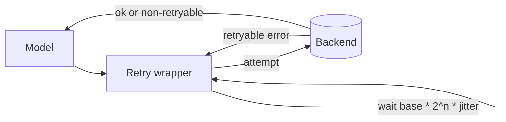
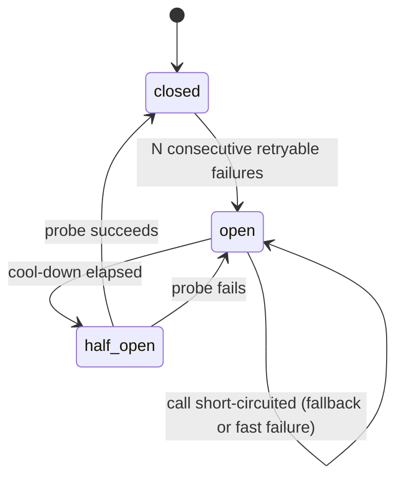

<!-- Generated by scripts/build_catalog.py. Edit patterns/failure-recovery/pattern.toml instead. -->

# Failure handling and retries

> Who retries a failed tool call, and when a retry is unsafe.

## Problem

Tools fail transiently, go down for minutes, and sometimes time out after having done the work. An agent has three places to respond: the model can read the error and try again, the runtime can retry underneath the model, or a breaker can stop calling a dead dependency and route elsewhere. Choosing wrongly wastes tokens, hammers a struggling backend, or performs a side effect twice.

**Practical applications**

- Agents over rate-limited or flaky APIs
- Agents with redundant data sources
- Any agent calling non-idempotent endpoints

## Recommendation

_This section is advice. The evidence behind it is under [Measured comparison](#measured-comparison)._

Send semantic errors (bad arguments, not found) to the model: only it can fix them. Retry transient infrastructure errors in the runtime with bounded, jittered backoff. Put a breaker in front of dependencies that can be down for a while, with a fallback if one exists. Never retry a non-idempotent call without an idempotency key.

## Solutions at a glance

| Solution | Status | Implementation | Example | Tests |
|---|---|---|---|---|
| [Model-mediated retry](#model-mediated-retry) | implemented | [`src/agentlab/loops/react.py`](../../src/agentlab/loops/react.py) | [`examples/10_failure_recovery.py`](../../examples/10_failure_recovery.py) | [`tests/test_recovery.py`](../../tests/test_recovery.py) |
| [Runtime retry with exponential backoff and jitter](#runtime-retry-with-exponential-backoff-and-jitter) | implemented | [`src/agentlab/recovery/policies.py`](../../src/agentlab/recovery/policies.py) | [`examples/10_failure_recovery.py`](../../examples/10_failure_recovery.py) | [`tests/test_recovery.py`](../../tests/test_recovery.py) |
| [Circuit breaker with fallback](#circuit-breaker-with-fallback) | implemented | [`src/agentlab/recovery/policies.py`](../../src/agentlab/recovery/policies.py) | [`examples/10_failure_recovery.py`](../../examples/10_failure_recovery.py) | [`tests/test_recovery.py`](../../tests/test_recovery.py) |
| [Idempotency keys for ambiguous outcomes](#idempotency-keys-for-ambiguous-outcomes) | implemented | [`src/agentlab/recovery/policies.py`](../../src/agentlab/recovery/policies.py) | [`examples/10_failure_recovery.py`](../../examples/10_failure_recovery.py) | [`tests/test_recovery.py`](../../tests/test_recovery.py) |

## Model-mediated retry

**Status:** implemented

Return the error as the observation and let the model decide to call again.

**Advantages**

- No extra machinery
- The right handler for errors the model caused

**Limitations**

- Every retry is a full model call over the transcript
- No backoff: it retries as fast as the model answers
- A lost reply on a non-idempotent call becomes a duplicate effect

**Performance.** Measured under 30% transient faults: 20.3 model calls and 11.2k tokens per task.

**Complexity.** None.

**Reliability.** Completes if the fault clears within the iteration budget.

**Security.** Error text is model input: do not put secrets or untrusted detail in it.

**Use when**

- Validation and semantic errors

**Avoid when**

- Infrastructure faults
- Non-idempotent tools

**Where you have seen it.** Default behaviour of tool-calling loops; MCP directs validation errors here.

## Runtime retry with exponential backoff and jitter

**Status:** implemented

A wrapper under the model retries retryable errors on idempotent calls with capped, jittered delays.



**Advantages**

- Transient faults never reach the model: no tokens spent
- Jitter avoids synchronised retries
- Refuses to retry non-idempotent calls unless they carry a key

**Limitations**

- Keeps hammering a backend that is down
- Adds latency the model cannot see

**Performance.** Measured under 30% transient faults: 16.5 model calls and 7.7k tokens per task.

**Complexity.** Small; part of a 83-SLOC middleware module.

**Reliability.** Through a 58s outage it made 62 backend calls and took 71.8s.

**Security.** Bound attempts and total delay so a failing dependency cannot be used to stall the agent.

**Use when**

- Transient errors on idempotent calls

**Avoid when**

- Long outages (add a breaker)
- Non-idempotent calls without keys

**Integration**

```python
from agentlab.recovery.policies import RetryingTools, RetryPolicy
tools = RetryingTools(registry, clock, RetryPolicy(max_attempts=4, base_ms=100, cap_ms=2000))
```

**Where you have seen it.** SDK-level retries (Anthropic and OpenAI clients); LangGraph node retry policies; Temporal activity retries.

## Circuit breaker with fallback

**Status:** implemented

After repeated failures stop calling the dependency for a cool-down, route to a fallback if there is one, then probe.



**Advantages**

- Fails fast instead of waiting on timeouts
- Protects the struggling dependency
- A fallback keeps the agent productive through an outage

**Limitations**

- Needs tuning (threshold, cool-down)
- A fallback with different freshness or semantics can introduce silent errors
- Per-process state unless shared

**Performance.** Through a 58s outage: 27 backend calls, 26.2s, 16 model calls.

**Complexity.** A three-state machine per tool.

**Reliability.** Caller errors do not trip it; only retryable failures count.

**Security.** The fallback tool is hidden from the model: routing is a runtime decision.

**Use when**

- Dependencies that can be down for minutes
- A replica or degraded path exists

**Avoid when**

- Single-shot scripts
- No meaningful fallback and failing slowly is acceptable

**Integration**

```python
from agentlab.recovery.policies import CircuitBreakerTools
tools = CircuitBreakerTools(RetryingTools(registry, clock), clock, threshold=3, cooldown_ms=5000, fallbacks={"lookup": "lookup_replica"})
```

**Where you have seen it.** Resilience libraries (resilience4j, Polly); service meshes.

## Idempotency keys for ambiguous outcomes

**Status:** implemented

Derive a key from the logical operation and send it with every side-effecting call, so a repeat after a lost reply is collapsed by the backend.

**Advantages**

- The only fix for timeouts that hide a successful effect
- Makes both runtime and model retries safe

**Limitations**

- Requires backend support
- The key must be stable across retries and distinct across operations

**Reliability.** Measured with 50% lost replies on `send`: 54% success without keys, 100% with them.

**Use when**

- Every non-idempotent tool

**Avoid when**

- Pure reads

**Integration**

```python
from agentlab.recovery.policies import IdempotentTools
tools = IdempotentTools(tools, namespace=run_id)     # outermost wrapper
```

**Where you have seen it.** Idempotency-Key headers; the MCP example server in this repo accepts `idempotency_key`.

## Measured comparison

From [`experiments/results/recovery.json`](../../experiments/results/recovery.json), produced by `python -m experiments.run_all`. **Question:** Should the model, the runtime, or a circuit breaker handle tool failures - and when is a retry unsafe?

**transient 30%**

| Strategy | Success | Model calls | Backend calls | Tokens | Sim time (ms) | Duplicate effects |
|---|---:|---:|---:|---:|---:|---:|
| model-mediated | 100.0% | 20.30 | 19.30 | 11,247 | 17,032 | 0.00 |
| backoff | 100.0% | 16.47 | 19.30 | 7,710 | 14,233 | 0.00 |
| backoff+idem | 100.0% | 16.09 | 19.30 | 7,419 | 13,957 | 0.00 |
| breaker+fallback | 100.0% | 16.91 | 19.29 | 8,276 | 14,584 | 0.00 |
| breaker+fallback+idem | 100.0% | 16.05 | 19.29 | 7,385 | 13,925 | 0.00 |

**outage 58s**

| Strategy | Success | Model calls | Backend calls | Tokens | Sim time (ms) | Duplicate effects |
|---|---:|---:|---:|---:|---:|---:|
| model-mediated | 100.0% | 48.00 | 47.00 | 57,465 | 70,965 | 0.00 |
| backoff | 100.0% | 27.00 | 62.00 | 19,609 | 71,751 | 0.00 |
| backoff+idem | 100.0% | 27.00 | 62.00 | 19,609 | 71,751 | 0.00 |
| breaker+fallback | 100.0% | 16.00 | 27.00 | 7,347 | 26,193 | 0.00 |
| breaker+fallback+idem | 100.0% | 16.00 | 27.00 | 7,347 | 26,193 | 0.00 |

**ambiguous timeout 50%**

| Strategy | Success | Model calls | Backend calls | Tokens | Sim time (ms) | Duplicate effects |
|---|---:|---:|---:|---:|---:|---:|
| model-mediated | 54.0% | 17.00 | 16.00 | 8,119 | 15,285 | 1.00 |
| backoff | 54.0% | 17.00 | 16.00 | 8,119 | 15,285 | 1.00 |
| backoff+idem | 100.0% | 16.00 | 15.46 | 7,347 | 13,911 | 0.00 |
| breaker+fallback | 54.0% | 18.92 | 16.00 | 10,371 | 16,821 | 1.00 |
| breaker+fallback+idem | 100.0% | 16.00 | 15.46 | 7,347 | 13,911 | 0.00 |

**Measured findings**

- Transient faults: everything completes, but model-mediated retry spends 20.3 model calls per task versus 16.5 with runtime backoff (11247 vs 7710 tokens).
- Sustained outage: backoff alone makes 62 backend calls and takes 72s; breaker + replica fallback makes 27 and takes 26s (2.7x faster).
- Ambiguous timeouts on a non-idempotent tool: without idempotency keys every stack succeeds on only 54% of tasks (duplicate sends); with keys 100% and 100%.

**Limitations of this experiment**

- Fault processes are independent per call; real outages are correlated across tools and time.
- The replica always holds fresh data. A stale replica would turn the fallback into a silent-error source.
- Simulated time: latencies and timeouts are fixed constants, not distributions.

## Research

- AWS Architecture Blog (Marc Brooker) (2015). [Exponential Backoff And Jitter](https://aws.amazon.com/blogs/architecture/exponential-backoff-and-jitter/).
- Martin Fowler (2014). [CircuitBreaker](https://martinfowler.com/bliki/CircuitBreaker.html).
- Stripe (Brandur Leach) (2017). [Designing robust and predictable APIs with idempotency](https://stripe.com/blog/idempotency).
- MCP project (2025). [MCP specification 2025-11-25: key changes](https://modelcontextprotocol.io/specification/2025-11-25/changelog).
- Hector Garcia-Molina and Kenneth Salem, SIGMOD (1987). [Sagas](https://dl.acm.org/doi/10.1145/38713.38742).
