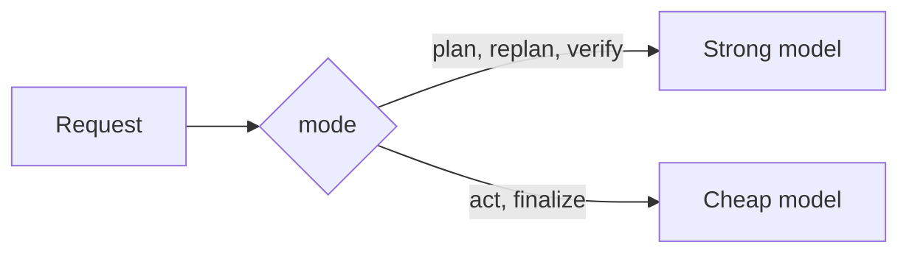
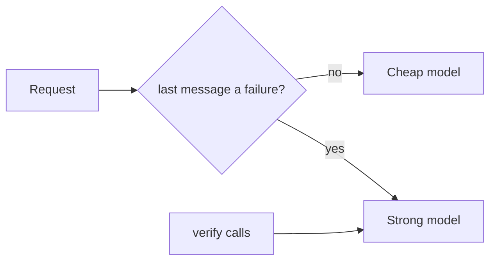

<!-- Generated by scripts/build_catalog.py. Edit patterns/model-routing/pattern.toml instead. -->

# Model selection and routing

> Which model answers which call.

## Problem

Strong models cost several times more than small ones and most calls in an agent run are easy. Routing every call to the strong model wastes money; routing every call to the small one loses reliability. A router needs a signal that says which calls deserve the strong model, and the architecture determines whether such a signal exists.

**Practical applications**

- High-volume agents with cost targets
- Planner/executor splits
- Worker agents under a stronger lead

## Recommendation

_This section is advice. The evidence behind it is under [Measured comparison](#measured-comparison)._

Routing needs a failure signal. If your loop has verification, cascade: run cheap, escalate when verification or a tool error says so. If roles differ in leverage, route by role. Without either, a router can only guess, and a static choice is the honest baseline.

## Solutions at a glance

| Solution | Status | Implementation | Example | Tests |
|---|---|---|---|---|
| [Static model](#static-model) | implemented | [`src/agentlab/routing/router.py`](../../src/agentlab/routing/router.py) | [`examples/12_model_routing.py`](../../examples/12_model_routing.py) | [`tests/test_routing.py`](../../tests/test_routing.py) |
| [Role-based routing](#role-based-routing) | implemented | [`src/agentlab/routing/router.py`](../../src/agentlab/routing/router.py) | [`examples/12_model_routing.py`](../../examples/12_model_routing.py) | [`tests/test_routing.py`](../../tests/test_routing.py) |
| [Cascade (escalate on evidence of failure)](#cascade-escalate-on-evidence-of-failure) | implemented | [`src/agentlab/routing/router.py`](../../src/agentlab/routing/router.py) | [`examples/12_model_routing.py`](../../examples/12_model_routing.py) | [`tests/test_routing.py`](../../tests/test_routing.py) |
| [Learned router](#learned-router) | documented | - | - | - |

## Static model

**Status:** implemented

One model for every call.

**Advantages**

- Predictable behaviour and cost
- One prompt cache

**Limitations**

- Overpays on easy calls or underperforms on hard ones

**Performance.** Measured on the verified graph: all-large 100% success at cost 20.7; all-small 80% at 2.7.

**Use when**

- Starting out
- Quality-critical work with no verifier

**Avoid when**

- Cost matters and a failure signal is available

**Where you have seen it.** Default.

## Role-based routing

**Status:** implemented

Strong model for rare, high-leverage calls (plan, verify); cheap model for frequent ones (act).



**Advantages**

- Static and predictable
- No failure detector needed

**Limitations**

- Useless when all calls have the same role (ReAct)
- If the high-leverage calls are also the long ones, savings are small

**Performance.** Measured on the verified graph: 100% success at cost 18.5 (all-large: 20.7).

**Use when**

- Loops with distinct planner / verifier / executor roles
- Supervisor with cheaper workers

**Avoid when**

- Single-role loops

**Where you have seen it.** Lead/sub-agent model splits; CrewAI manager_llm; advisor patterns.

## Cascade (escalate on evidence of failure)

**Status:** implemented

Run on the cheap model; switch to the strong model for a call when the latest context shows a failed tool call or a verifier rejection.



**Advantages**

- Pays for the strong model only where there is evidence it is needed
- Composes with any loop: it is just a Model

**Limitations**

- Only as good as the failure signal: silent errors never escalate
- Mixed models split prompt caches
- Behaviour differs between the easy and hard path, which complicates testing

**Performance.** Measured on the verified graph: 98% at cost 17.1; with the verifier also on the cheap model 94% at 7.4. On ReAct, which has no verifier, the cascade reached 48% against 44% all-small.

**Reliability.** Inherits the verifier's miss rate.

**Use when**

- A verifier or loud tool errors exist
- Most calls are easy

**Avoid when**

- No failure signal
- Errors are mostly silent and unverified

**Integration**

```python
from agentlab.routing.router import CascadeRouter, RoutedModel
model = RoutedModel({"small": small, "large": large}, CascadeRouter("large", "small"))
```

**Where you have seen it.** FrugalGPT; fallback-on-error model chains.

## Learned router

**Status:** documented (described for comparison; not implemented in this repository)

Train a classifier on preference or outcome data to predict which model a query needs before answering it.

**Advantages**

- Routes before spending anything
- Can beat heuristics where data exists

**Limitations**

- Needs labelled data from your own traffic
- Drifts as models and tasks change

**Use when**

- High volume with outcome labels

**Avoid when**

- Low volume or no labels

**Where you have seen it.** RouteLLM. Not implemented here: the simulator has no query features to learn from.

## Measured comparison

From [`experiments/results/routing.json`](../../experiments/results/routing.json), produced by `python -m experiments.run_all`. **Question:** Can a router buy large-model reliability at small-model prices, and what does it need to work?

**react**

| Router | Success | Cost | Model calls | Tokens | Repairs |
|---|---:|---:|---:|---:|---:|
| all-small | 44.5% | 2.76 | 17.95 | 9,433 | 0.00 |
| all-large | 87.5% | 30.41 | 17.08 | 8,622 | 0.00 |
| role (plan/verify large) | 44.5% | 2.76 | 17.95 | 9,433 | 0.00 |
| cascade (escalate on failure) | 48.5% | 5.71 | 17.82 | 9,301 | 0.00 |
| cascade, small verifier | 48.5% | 5.71 | 17.82 | 9,301 | 0.00 |

**plan_execute**

| Router | Success | Cost | Model calls | Tokens | Repairs |
|---|---:|---:|---:|---:|---:|
| all-small | 44.5% | 1.24 | 3.96 | 2,919 | 0.00 |
| all-large | 87.5% | 10.83 | 3.08 | 1,966 | 0.00 |
| role (plan/verify large) | 87.5% | 8.65 | 3.08 | 1,966 | 0.00 |
| cascade (escalate on failure) | 79.5% | 5.73 | 3.25 | 2,147 | 0.00 |
| cascade, small verifier | 79.5% | 5.73 | 3.25 | 2,147 | 0.00 |

**verified_graph**

| Router | Success | Cost | Model calls | Tokens | Repairs |
|---|---:|---:|---:|---:|---:|
| all-small | 80.0% | 2.73 | 9.72 | 8,458 | 0.92 |
| all-large | 99.5% | 20.75 | 7.37 | 5,154 | 0.14 |
| role (plan/verify large) | 99.5% | 18.50 | 7.37 | 5,154 | 0.14 |
| cascade (escalate on failure) | 98.0% | 17.10 | 7.75 | 5,773 | 0.26 |
| cascade, small verifier | 94.0% | 7.37 | 7.62 | 5,582 | 0.18 |

**Measured findings**

- ReAct: all-large succeeds 88% at cost 30.4; all-small 44% at 2.8. The cascade reaches only 48%: it escalates on loud errors but silent errors give it no signal.
- Verified graph: the cascade reaches 98% at cost 17.1 versus all-large 100% at 20.7 (-18% cost).
- Keeping the verifier on the small model too ('cascade, small verifier') costs 7.4 and reaches 94%: most of the routed cost is the strong verifier re-reading the transcript, and most of the reliability comes from it.
- Role routing on the verified graph: 100% at cost 18.5. On ReAct it equals all-small because every ReAct call has the same role.
- Configurations above 90% success, cheapest first: verified_graph/cascade, small verifier (94%, 7.4); verified_graph/cascade (escalate on failure) (98%, 17.1); verified_graph/role (plan/verify large) (100%, 18.5).

**Limitations of this experiment**

- Prices and error rates are assumptions chosen for a 12x price ratio; they are not measurements of any real model.
- The large model's slips are a strict subset of the small model's (coupled draws). Real models fail on different inputs.
- No learned router is evaluated; RouteLLM-style routers need preference data this simulator cannot provide.

## Research

- Lingjiao Chen et al. (3 authors) (2023). [FrugalGPT: How to Use Large Language Models While Reducing Cost and Improving Performance](https://arxiv.org/abs/2305.05176).
- Isaac Ong et al. (8 authors) (2024). [RouteLLM: Learning to Route LLMs with Preference Data](https://arxiv.org/abs/2406.18665).
