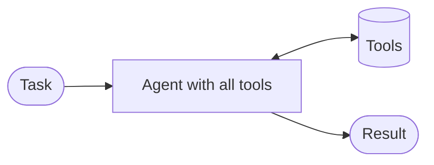
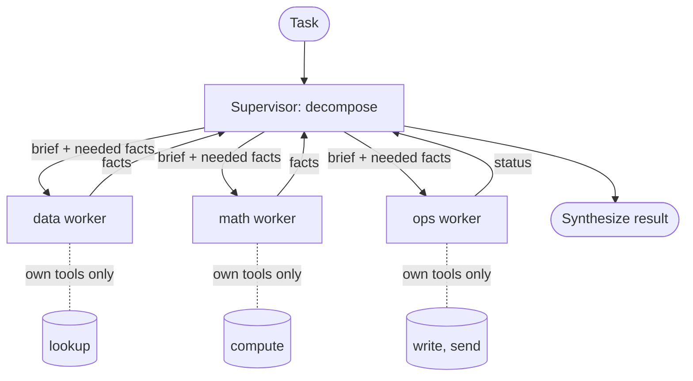
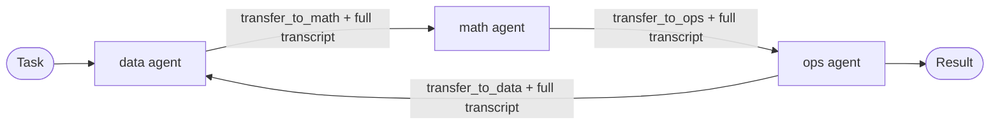

<!-- Generated by scripts/build_catalog.py. Edit patterns/orchestration/pattern.toml instead. -->

# Multi-agent orchestration

> Whether to split work across agents, and who holds the context when you do.

## Problem

A task spans several skills or is too long for one context window. Splitting it across agents can isolate context, restrict each agent's tools and run parts in parallel, but every split is also a place where information is lost and where a failed agent can take work with it. The architecture decides who coordinates, what crosses agent boundaries, and what happens when an agent dies.

**Practical applications**

- Research and analysis fan-out over independent sources
- Pipelines with distinct privilege levels (read data, compute, perform effects)
- Customer-facing triage that routes to specialists

## Recommendation

_This section is advice. The evidence behind it is under [Measured comparison](#measured-comparison)._

Stay with one agent until context size, privilege separation or wall-clock time forces a split. If subtasks are independent and can be briefed in a few lines, use a supervisor with isolated workers. If the work is one continuous conversation that changes hands, use handoffs, and make the baton durable if losing a conversation is unacceptable.

## Solutions at a glance

| Solution | Status | Implementation | Example | Tests |
|---|---|---|---|---|
| [Single agent (baseline)](#single-agent-baseline) | implemented | [`src/agentlab/loops/react.py`](../../src/agentlab/loops/react.py) | [`examples/01_react_loop.py`](../../examples/01_react_loop.py) | [`tests/test_orchestration.py`](../../tests/test_orchestration.py) |
| [Supervisor with isolated specialist workers](#supervisor-with-isolated-specialist-workers) | implemented | [`src/agentlab/orchestration/supervisor.py`](../../src/agentlab/orchestration/supervisor.py) | [`examples/04_supervisor_workers.py`](../../examples/04_supervisor_workers.py) | [`tests/test_orchestration.py`](../../tests/test_orchestration.py) |
| [Peer-to-peer handoff](#peer-to-peer-handoff) | implemented | [`src/agentlab/orchestration/handoff.py`](../../src/agentlab/orchestration/handoff.py) | [`examples/05_peer_handoff.py`](../../examples/05_peer_handoff.py) | [`tests/test_orchestration.py`](../../tests/test_orchestration.py) |
| [Shared blackboard / group chat with a speaker selector](#shared-blackboard--group-chat-with-a-speaker-selector) | documented | - | - | - |

## Single agent (baseline)

**Status:** implemented

One loop, one context, all tools. The option every multi-agent design must beat.



**Advantages**

- No coordination overhead and no information lost between agents
- Simplest to trace and debug
- Fewest model calls

**Limitations**

- Context grows with the whole task
- One agent holds every permission
- Strictly sequential

**Performance.** Measured at 57 steps: 58 model calls, 82.9k tokens, peak context 2,269.

**Complexity.** None beyond the loop.

**Reliability.** One process to make durable (see durable-execution).

**Security.** No privilege separation: an injected instruction reaches every tool the task needs.

**Use when**

- The task fits comfortably in one context
- Steps are tightly coupled

**Avoid when**

- Context or latency limits are binding
- Parts of the task need different privileges

**Where you have seen it.** Any single-agent loop.

## Supervisor with isolated specialist workers

**Status:** implemented

A supervisor decomposes once; code schedules subtasks onto workers as inputs become ready. Each worker gets a brief, its own tools and a fresh context, and returns condensed facts.



**Advantages**

- Context isolation: each worker's context holds one subtask, not the whole history
- Least privilege falls out of the structure: a worker only has its domain's tools
- Independent subtasks run in parallel
- A crashed worker is detected and its subtask reassigned

**Limitations**

- Workers know only what the brief says; an under-specified brief fails silently
- More model calls than a single agent
- The supervisor is a single point of failure and must itself be durable
- Reassigning a half-finished subtask repeats its side effects unless calls are idempotent

**Performance.** Measured at 57 steps: 11.1k tokens and peak context 446 (single agent: 82.9k and 2,269), but 85 model calls. Makespan 23.0s with three workers per skill versus 39.6s with one. These token savings hold for cleanly decomposable tasks with compact results; open-ended research has been reported at about 15x chat usage.

**Complexity.** 136 SLOC, 36 branch points, most of it scheduling and failure handling.

**Reliability.** Measured with an ops worker dying mid-subtask: 50% correct completion, 100% with idempotency keys.

**Security.** Workers cannot call tools outside their scope even if instructed to. The supervisor never touches tools at all.

**Use when**

- Subtasks are independent and can be specified in a short brief
- Privilege separation matters
- Wall-clock time matters and work can run in parallel

**Avoid when**

- Subtasks share subtle context that a brief would lose
- The task is short: at 15 steps it needed 25 model calls and 14.9s against 16 calls and 13.4s for one agent

**Integration**

```python
from agentlab.orchestration.supervisor import SupervisorWorkers
sup = SupervisorWorkers(model, tools, clock=clock, pool={"data": 2, "math": 2, "ops": 1}, idempotent=True)
result = sup.run(task)      # result.timeline is the per-worker schedule
```
The model must answer a `decompose` request with subtasks `{id, domain, steps, needs}`.

**Where you have seen it.** CrewAI hierarchical process; LangGraph supervisor graphs; Magentic-One orchestrator; Anthropic orchestrator-workers; A2A task delegation.

## Peer-to-peer handoff

**Status:** implemented

No coordinator. The active specialist works until the next step is outside its tools, then transfers the conversation, whole, to a peer.



**Advantages**

- Nothing is lost at a boundary: the receiver sees everything
- No coordinator to build, pay for or keep alive
- Tool scoping per agent, like the supervisor

**Limitations**

- The transcript travels and grows: the most expensive option on long tasks
- Each handoff is an extra model turn
- Strictly sequential
- The active agent is the only holder of the conversation; if it dies the task is gone unless the handoff envelope was persisted and a replica exists

**Performance.** Measured at 57 steps: 165.8k tokens over 25 handoffs; peak context 3,426.

**Complexity.** 107 SLOC, 22 branch points.

**Reliability.** Measured with the ops agent dying mid-turn: 0% completion as-is; 50% with a durable baton and a replica; 100% when calls also carry idempotency keys.

**Security.** Per-agent tool scopes hold, but every agent reads the full transcript, so untrusted text reaches all of them.

**Use when**

- One conversation that changes hands (triage to specialist)
- Boundaries are few
- Losing context at a boundary is worse than paying for it

**Avoid when**

- Many alternations between skills
- Long tasks
- You need parallelism

**Integration**

```python
from agentlab.orchestration.handoff import HandoffSwarm
swarm = HandoffSwarm(model, tools, clock=clock, replicas={"ops": 2}, redeliver=True, idempotent=True)
result = swarm.run(task)
```
Handoffs are ordinary tools named `transfer_to_<skill>`; a real model needs no special support.

**Where you have seen it.** OpenAI Agents SDK handoffs; Swarm; LangGraph swarm; AutoGen Swarm.

## Shared blackboard / group chat with a speaker selector

**Status:** documented (described for comparison; not implemented in this repository)

All agents read and write one shared record; a selector (model or rule) picks who acts next.

**Advantages**

- Opportunistic collaboration without a fixed plan
- Shared state is the single source of truth

**Limitations**

- Selector calls on every turn
- Shared context grows like a single agent's
- Hard to bound and to test

**Use when**

- Loosely structured problem solving where the order of contributions is not known in advance

**Avoid when**

- Tasks with a known dependency structure

**Where you have seen it.** AutoGen group chat with selector; Magentic-One ledger. Not implemented here; see the roadmap.

## Measured comparison

From [`experiments/results/orchestration.json`](../../experiments/results/orchestration.json), produced by `python -m experiments.run_all`. **Question:** When does splitting work across agents pay off, and which topology survives an agent crash?

**no fault, 2 stages (15 steps)**

| Architecture | Success | Model calls | Tokens | Peak context | Agent messages | Makespan (ms) | Duplicate effects |
|---|---:|---:|---:|---:|---:|---:|---:|
| single agent (react) | 100.0% | 16.00 | 7,341 | 664 | 0.00 | 13,365 | 0.00 |
| supervisor, 1 worker/skill | 100.0% | 25.00 | 2,778 | 149 | 16.00 | 14,890 | 0.00 |
| supervisor, 3 workers/skill | 100.0% | 25.00 | 2,778 | 149 | 16.00 | 11,515 | 0.00 |
| peer handoff | 100.0% | 23.00 | 13,746 | 983 | 7.00 | 18,965 | 0.00 |

**no fault, 4 stages (29 steps)**

| Architecture | Success | Model calls | Tokens | Peak context | Agent messages | Makespan (ms) | Duplicate effects |
|---|---:|---:|---:|---:|---:|---:|---:|
| single agent (react) | 100.0% | 30.00 | 23,435 | 1,199 | 0.00 | 24,955 | 0.00 |
| supervisor, 1 worker/skill | 100.0% | 45.00 | 5,374 | 228 | 28.00 | 23,085 | 0.00 |
| supervisor, 3 workers/skill | 100.0% | 45.00 | 5,374 | 228 | 28.00 | 16,445 | 0.00 |
| peer handoff | 100.0% | 43.00 | 45,670 | 1,797 | 13.00 | 35,355 | 0.00 |

**no fault, 8 stages (57 steps)**

| Architecture | Success | Model calls | Tokens | Peak context | Agent messages | Makespan (ms) | Duplicate effects |
|---|---:|---:|---:|---:|---:|---:|---:|
| single agent (react) | 100.0% | 58.00 | 82,852 | 2,269 | 0.00 | 48,135 | 0.00 |
| supervisor, 1 worker/skill | 100.0% | 85.00 | 11,093 | 446 | 52.00 | 39,585 | 0.00 |
| supervisor, 3 workers/skill | 100.0% | 85.00 | 11,093 | 446 | 52.00 | 22,985 | 0.00 |
| peer handoff | 100.0% | 83.00 | 165,774 | 3,426 | 25.00 | 68,135 | 0.00 |

**ops agent dies right after its k-th tool call, k in 1..4 (4 stages, per-stage notifications)**

| Architecture | Success | Model calls | Tokens | Peak context | Agent messages | Makespan (ms) | Duplicate effects |
|---|---:|---:|---:|---:|---:|---:|---:|
| supervisor (respawn) | 50.0% | 50.50 | 6,352 | 262 | 29.00 | 26,905 | 0.50 |
| supervisor (respawn) + idem | 100.0% | 50.50 | 6,352 | 262 | 29.00 | 26,905 | 0.00 |
| peer handoff | 0.0% | 13.30 | 7,981 | 777 | 3.44 | 16,039 | 0.00 |
| peer handoff, durable baton + replica | 50.0% | 48.50 | 55,748 | 1,954 | 13.00 | 45,355 | 0.50 |
| peer handoff, durable baton + replica + idem | 100.0% | 48.50 | 55,748 | 1,954 | 13.00 | 45,355 | 0.00 |

**Measured findings**

- On 57-step decomposable tasks the supervisor uses 11093 tokens vs 82852 for one ReAct agent (-87%): each worker starts from a fresh context (peak 446 vs 2269 tokens).
- Peer handoff is the most expensive: 165774 tokens (2.0x the single agent), because the full transcript travels with every one of 25 handoffs and each handoff is an extra model call.
- Parallel workers cut wall-clock: makespan 23.0s with 3 workers per skill vs 39.6s with 1 and 48.1s single-agent, for the same total tokens.
- The supervisor makes more model calls than the single agent (85 vs 58): coordination adds calls even while it removes tokens.
- Agent crash: the supervisor reassigns and finishes 50% correctly (the rest duplicate a notification), 100% with idempotency keys. A plain handoff chain finishes 0%; with a durable baton and a replica 50%, and 100% with keys.

**Limitations of this experiment**

- Tasks decompose cleanly and the decomposition is always correct. A published taxonomy (MAST, arXiv:2503.13657) lists 14 failure modes observed in real multi-agent systems; this simulator models exactly one failure class, an agent crash.
- Workers return compact structured facts. Open-ended research tasks return long prose and can use far more tokens than a single agent (Anthropic reports about 15x chat usage for its multi-agent research system).
- Parallelism is a virtual-time schedule computed from measured per-subtask durations, not real concurrent execution.

## Research

- Qingyun Wu et al. (14 authors) (2023). [AutoGen: Enabling Next-Gen LLM Applications via Multi-Agent Conversation](https://arxiv.org/abs/2308.08155).
- Sirui Hong et al. (15 authors) (2023). [MetaGPT: Meta Programming for A Multi-Agent Collaborative Framework](https://arxiv.org/abs/2308.00352).
- Guohao Li et al. (5 authors) (2023). [CAMEL: Communicative Agents for "Mind" Exploration of Large Language Model Society](https://arxiv.org/abs/2303.17760).
- Adam Fourney et al. (20 authors) (2024). [Magentic-One: A Generalist Multi-Agent System for Solving Complex Tasks](https://arxiv.org/abs/2411.04468).
- Mert Cemri et al. (13 authors) (2025). [Why Do Multi-Agent LLM Systems Fail?](https://arxiv.org/abs/2503.13657).
- Anthropic (2025). [How we built our multi-agent research system](https://www.anthropic.com/engineering/multi-agent-research-system).
- Cognition (2025). [Don't Build Multi-Agents](https://cognition.ai/blog/dont-build-multi-agents).
- OpenAI (2026). [OpenAI Agents SDK: Handoffs](https://openai.github.io/openai-agents-python/handoffs/).
- CrewAI (2026). [CrewAI: Processes](https://docs.crewai.com/en/concepts/processes).
- A2A project / Linux Foundation (2026). [Agent2Agent (A2A) Protocol specification](https://a2a-protocol.org/latest/specification/).
