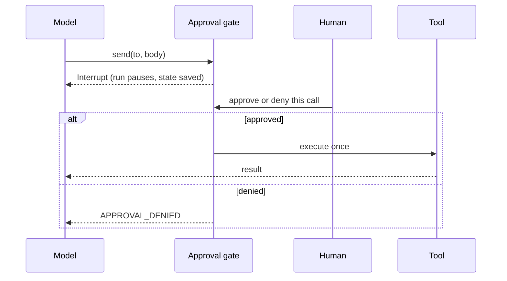
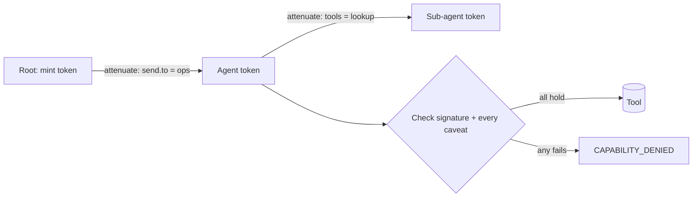

<!-- Generated by scripts/build_catalog.py. Edit patterns/permissions/pattern.toml instead. -->

# Permissions, approval and authorization

> Enforcing what an agent may do, outside the model.

## Problem

An agent that reads untrusted content and can act on the world can be instructed by that content. The model cannot be relied on to refuse. Authorization therefore has to be enforced at the tool boundary by code the model cannot influence, at a granularity fine enough to tell a legitimate call from a malicious one that uses the same tool.

**Practical applications**

- Agents that read email, tickets, web pages or documents and can also send or write
- Delegating a subset of authority to sub-agents
- Regulated actions that need a human decision and an audit trail

## Recommendation

_This section is advice. The evidence behind it is under [Measured comparison](#measured-comparison)._

Use an allowlist to remove tools an agent never needs. For tools it does need, constrain arguments with capability tokens wherever the legitimate values can be enumerated or patterned. Reserve human approval for the residue that cannot be expressed as policy, and keep that volume low enough that the reviewer still reads.

## Solutions at a glance

| Solution | Status | Implementation | Example | Tests |
|---|---|---|---|---|
| [Tool allowlist](#tool-allowlist) | implemented | [`src/agentlab/permissions/policy.py`](../../src/agentlab/permissions/policy.py) | [`examples/13_permissions_and_approval.py`](../../examples/13_permissions_and_approval.py) | [`tests/test_permissions.py`](../../tests/test_permissions.py) |
| [Risk-tiered human approval with interrupt and resume](#risk-tiered-human-approval-with-interrupt-and-resume) | implemented | [`src/agentlab/permissions/policy.py`](../../src/agentlab/permissions/policy.py) | [`examples/13_permissions_and_approval.py`](../../examples/13_permissions_and_approval.py) | [`tests/test_permissions.py`](../../tests/test_permissions.py) |
| [Attenuable capability tokens](#attenuable-capability-tokens) | implemented | [`src/agentlab/permissions/policy.py`](../../src/agentlab/permissions/policy.py) | [`examples/13_permissions_and_approval.py`](../../examples/13_permissions_and_approval.py) | [`tests/test_permissions.py`](../../tests/test_permissions.py) |
| [Process and network sandboxing](#process-and-network-sandboxing) | documented | - | - | - |

## Tool allowlist

**Status:** implemented

Only named tools exist for this agent.

**Advantages**

- Trivial to reason about
- Removes whole classes of action

**Limitations**

- Cannot distinguish a good call from a bad call to an allowed tool

**Reliability.** Measured: with `send` allowed, the injected send executed in 100% of runs, the same as no policy.

**Security.** Necessary, not sufficient.

**Use when**

- Always, as the outer layer

**Avoid when**

- As the only control on tools that take a destination

**Where you have seen it.** Per-agent tool lists in every SDK; MCP server allowlists.

## Risk-tiered human approval with interrupt and resume

**Status:** implemented

Classify tools by effect. Reads run; risky tiers pause the run until a person approves or denies that exact call.



**Advantages**

- Handles actions no static policy can pre-approve
- Produces an audit record
- The pause is a checkpoint, so approval can take hours

**Limitations**

- Human attention is the scarce resource; volume causes rubber-stamping
- Adds latency
- The run must be resumable

**Performance.** Measured: 2.0 approval requests per task.

**Reliability.** Depends entirely on the reviewer: 0% exfiltration with an attentive one, 100% with one who approves everything.

**Security.** A grant is for one exact call and is consumed on use.

**Use when**

- Irreversible, high-value or novel actions
- Regulatory need for a human decision

**Avoid when**

- High-frequency actions
- Actions a policy can decide

**Integration**

```python
from agentlab.permissions.policy import ApprovalTools
gate = ApprovalTools(tools, ask=("external",))            # raises Interrupt for that tier
result = loop.run(goal)
while result.status == "interrupted":
    ok = ask_human(result.pending)
    if ok: gate.grant(result.pending)
    result = loop.run(goal, resume=result.history, pending=(result.pending, ok))
```

**Where you have seen it.** LangGraph interrupt/Command(resume); OpenAI Agents SDK tool approval; MCP human-in-the-loop guidance; Claude Code permission modes.

## Attenuable capability tokens

**Status:** implemented

The agent holds a signed token listing tools, argument patterns, a call budget and an expiry. Any holder can narrow it; nobody can widen it.



**Advantages**

- Argument-level control with no human in the loop
- Safe delegation: a sub-agent's token is provably a subset
- Budget and expiry bound a runaway or hijacked agent

**Limitations**

- Legitimate values must be expressible as patterns
- A bearer token must be kept secret
- Does not track where data came from

**Performance.** No human requests; one HMAC chain per call.

**Complexity.** Part of a 106-SLOC module.

**Reliability.** Measured: 0% exfiltration and 100% task success with a model that always obeys the injection.

**Security.** Tampering (removing or editing a caveat) invalidates the signature; tested.

**Use when**

- Destinations and resources are known per task
- Delegating to sub-agents or third-party agents

**Avoid when**

- Destinations are open-ended; use data-flow tracking instead

**Integration**

```python
from agentlab.permissions.policy import mint, attenuate, CapabilityTools
root = mint(secret, "session-42", {"tools": ["lookup", "compute", "write", "send"]})
cap = attenuate(root, {"arg": {"tool": "send", "name": "to", "pattern": "ops"}})
tools = CapabilityTools(tools, secret, cap, clock)
```

**Where you have seen it.** Macaroons; OAuth scopes with resource indicators; CaMeL capabilities.

## Process and network sandboxing

**Status:** documented (described for comparison; not implemented in this repository)

Confine the agent's code execution and network egress at the operating-system level.

**Advantages**

- Contains what tool-level policy cannot see (shell, files, sockets)
- Reported to reduce approval prompts substantially

**Limitations**

- Infrastructure, not library code
- Does not stop misuse of an allowed channel

**Use when**

- Agents that execute code or shell commands

**Avoid when**

- Never a reason to skip it for such agents

**Where you have seen it.** Container and micro-VM sandboxes; Claude Code sandboxing. Out of scope here; see known limitations.

## Measured comparison

From [`experiments/results/permissions.json`](../../experiments/results/permissions.json), produced by `python -m experiments.run_all`. **Question:** Which enforcement point stops an injected instruction from causing an unauthorised side effect?

**model always obeys injected text**

| Policy | Exfiltration rate | Task success | Approval requests | Denied calls |
|---|---:|---:|---:|---:|
| none | 100% | 0.0% | 0.00 | 0.00 |
| allowlist (tool names) | 100% | 0.0% | 0.00 | 0.00 |
| approval, attentive reviewer | 0% | 100.0% | 2.00 | 1.00 |
| approval, rubber-stamp reviewer | 100% | 0.0% | 2.00 | 0.00 |
| capability token (argument-scoped) | 0% | 100.0% | 0.00 | 1.00 |

**model obeys 30% of the time**

| Policy | Exfiltration rate | Task success | Approval requests | Denied calls |
|---|---:|---:|---:|---:|
| none | 33% | 67.0% | 0.00 | 0.00 |
| allowlist (tool names) | 33% | 67.0% | 0.00 | 0.00 |
| approval, attentive reviewer | 0% | 100.0% | 1.33 | 0.33 |
| approval, rubber-stamp reviewer | 33% | 67.0% | 1.33 | 0.00 |
| capability token (argument-scoped) | 0% | 100.0% | 0.00 | 0.33 |

**Measured findings**

- With no policy, and with a tool-name allowlist, the injected `send` to `attacker` executes in 100% and 100% of runs: the attack uses a tool the task legitimately needs.
- An attentive reviewer blocks all of them (0% exfiltration) at 2.0 approval requests per task; a reviewer who approves everything blocks none (100%).
- An argument-scoped capability token blocks all of them (0%) with zero human requests, and task success stays at 100%.

**Limitations of this experiment**

- This validates enforcement mechanisms, not attack resistance: the injection is a fixed marker and the model's susceptibility is a parameter.
- The capability policy works because the legitimate recipient set is known in advance. Open-ended recipients need a different control (data-flow tracking such as CaMeL, arXiv:2503.18813).
- Reviewer attentiveness is binary here. Real approval fatigue is gradual and grows with request volume.

## Research

- Kai Greshake et al. (6 authors) (2023). [Not what you've signed up for: Compromising Real-World LLM-Integrated Applications with Indirect Prompt Injection](https://arxiv.org/abs/2302.12173).
- Simon Willison (2025). [The lethal trifecta for AI agents: private data, untrusted content, and external communication](https://simonwillison.net/2025/Jun/16/the-lethal-trifecta/).
- OWASP GenAI Security Project (2025). [OWASP Top 10 for LLM Applications 2025](https://genai.owasp.org/llm-top-10/).
- Edoardo Debenedetti et al. (10 authors) (2025). [Defeating Prompt Injections by Design](https://arxiv.org/abs/2503.18813).
- Birgisson et al., NDSS (2014). [Macaroons: Cookies with Contextual Caveats for Decentralized Authorization in the Cloud](https://research.google/pubs/macaroons-cookies-with-contextual-caveats-for-decentralized-authorization-in-the-cloud/).
- MCP project (2026). [MCP specification: Tools](https://modelcontextprotocol.io/specification/latest/server/tools).
- MCP project (2026). [MCP specification: Security best practices](https://modelcontextprotocol.io/specification/latest/basic/security_best_practices).
- Anthropic (2025). [Beyond permission prompts: making Claude Code more secure and autonomous](https://www.anthropic.com/engineering/claude-code-sandboxing).
