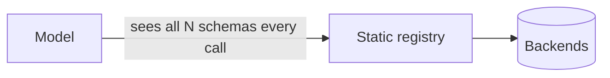
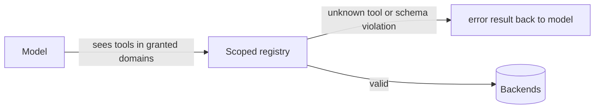
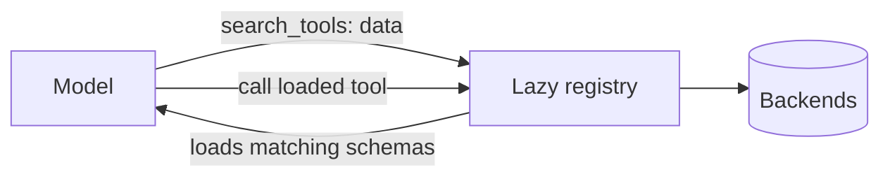

<!-- Generated by scripts/build_catalog.py. Edit patterns/tool-registry/pattern.toml instead. -->

# Tool registries and capability routing

> Which tools the model sees, and what reaches the backend.

## Problem

Tool catalogues grow. Every schema shown to the model costs tokens on every call and widens what a confused or manipulated model can do, while a schema it cannot see is a tool it cannot use. The registry decides what is exposed, when, and whether a malformed call is stopped before it reaches a real system.

**Practical applications**

- Agents connected to several MCP servers
- Internal platforms exposing dozens of APIs to one assistant
- Per-agent tool scoping in multi-agent systems

## Recommendation

_This section is advice. The evidence behind it is under [Measured comparison](#measured-comparison)._

With a handful of tools, expose them all. Once a catalogue reaches dozens, scope by capability if you know what the task needs up front, and load lazily if you do not. Validate arguments against the schema before execution in every case: it is cheap and keeps malformed calls out of your systems.

## Solutions at a glance

| Solution | Status | Implementation | Example | Tests |
|---|---|---|---|---|
| [Static registry](#static-registry) | implemented | [`src/agentlab/tools/registry.py`](../../src/agentlab/tools/registry.py) | [`examples/08_tool_registries.py`](../../examples/08_tool_registries.py) | [`tests/test_tools.py`](../../tests/test_tools.py) |
| [Capability-scoped registry with schema validation](#capability-scoped-registry-with-schema-validation) | implemented | [`src/agentlab/tools/registry.py`](../../src/agentlab/tools/registry.py) | [`examples/08_tool_registries.py`](../../examples/08_tool_registries.py) | [`tests/test_tools.py`](../../tests/test_tools.py) |
| [Lazy discovery (tool search)](#lazy-discovery-tool-search) | implemented | [`src/agentlab/tools/registry.py`](../../src/agentlab/tools/registry.py) | [`examples/08_tool_registries.py`](../../examples/08_tool_registries.py) | [`tests/test_tools.py`](../../tests/test_tools.py) |

## Static registry

**Status:** implemented

Every tool is always exposed. Calls go straight to the backend.



**Advantages**

- Nothing to configure; no discovery step
- The model can always reach every tool

**Limitations**

- Prompt cost scales with catalogue size times model calls
- Malformed calls reach the backend
- No least privilege

**Performance.** Measured with 39 tools: 33.4k prompt tokens per 15-step task.

**Complexity.** A dictionary.

**Reliability.** With 10% malformed calls, 1.81 bad calls per task reached the backend.

**Security.** Everything is callable by a manipulated model.

**Use when**

- Small, stable tool sets

**Avoid when**

- Catalogues of dozens of tools
- Backends that should never see malformed input

**Where you have seen it.** The default in most SDKs.

## Capability-scoped registry with schema validation

**Status:** implemented

Expose only tools in the capability domains granted to this agent or task; reject calls that violate the schema before execution. Scopes can only narrow.



**Advantages**

- Cuts prompt tokens to the tools that matter
- Least privilege per agent; a narrowed scope cannot be widened
- Schema violations return to the model as correctable errors without touching the backend

**Limitations**

- Someone must know the needed capabilities in advance
- A tool outside the scope is unreachable even when it would have helped

**Performance.** Measured: 7.0k prompt tokens per task against 33.4k static.

**Complexity.** Domain tags on tools plus a validator.

**Reliability.** With 10% malformed calls, 1.70 per task were rejected before execution and 0.11 reached the backend (semantic errors a schema cannot express).

**Security.** The structural basis for per-worker privilege separation in the supervisor pattern.

**Use when**

- Known task types
- Multi-agent systems with specialist roles
- Any backend that must be shielded from malformed calls

**Avoid when**

- Open-ended assistants that may need anything

**Integration**

```python
from agentlab.tools.registry import ScopedRegistry
registry = ScopedRegistry(all_tools, domains=["data", "math", "ops"])
worker_view = registry.scope(["math"])     # can only shrink
```

**Where you have seen it.** OpenAI Agents SDK per-agent tools; MCP server allowlists; LangGraph tool nodes per subgraph.

## Lazy discovery (tool search)

**Status:** implemented

Expose one search tool. The model asks for a capability; matching schemas are loaded into context for the rest of the run.



**Advantages**

- Scales to catalogues too large to show
- No up-front knowledge of what the task needs

**Limitations**

- One extra model call per capability discovered
- Depends on search quality; a missed tool is an invisible tool
- Changing the tool list mid-run invalidates prompt caches on real APIs

**Performance.** Measured: 9.4k prompt tokens per task and 19 model calls (static: 16).

**Complexity.** A search function and a loaded-set.

**Reliability.** A tool that is not loaded returns a clear error telling the model to search.

**Security.** Smaller standing exposure than static, but any tool in the catalogue is one search away.

**Use when**

- Very large or changing catalogues
- General assistants

**Avoid when**

- Few tools
- Latency-critical short tasks

**Integration**

```python
from agentlab.tools.registry import LazyRegistry
registry = LazyRegistry(all_tools, preload=["lookup"], top_k=4)
```

**Where you have seen it.** Anthropic tool search tool (defer_loading); RAG-MCP; MCP tool-list change notifications.

## Measured comparison

From [`experiments/results/tools.json`](../../experiments/results/tools.json), produced by `python -m experiments.run_all`. **Question:** What does it cost to show the model every tool, and what do scoping and lazy loading buy?

**perfect model**

| Registry | Success | Prompt tokens | Model calls | Schemas exposed at end | Rejected before backend | Bad calls reaching backend |
|---|---:|---:|---:|---:|---:|---:|
| static | 100.0% | 33,440 | 16.00 | 39.00 | 0.00 | 0.00 |
| scoped | 100.0% | 7,008 | 16.00 | 4.00 | 0.00 | 0.00 |
| lazy | 100.0% | 9,433 | 19.00 | 5.00 | 0.00 | 0.00 |

**loud slips 10%**

| Registry | Success | Prompt tokens | Model calls | Schemas exposed at end | Rejected before backend | Bad calls reaching backend |
|---|---:|---:|---:|---:|---:|---:|
| static | 100.0% | 37,959 | 17.81 | 39.00 | 0.00 | 1.81 |
| scoped | 100.0% | 8,564 | 17.81 | 4.00 | 1.70 | 0.11 |
| lazy | 100.0% | 11,172 | 20.81 | 5.00 | 0.00 | 1.81 |

**Measured findings**

- Exposing all 40 schemas on every call costs 33440 prompt tokens per task; scoping to the task's three capability domains costs 7008 (-79%); lazy discovery costs 9433 (-72%).
- Lazy discovery pays 3 extra model calls per task (one search per capability) and ends with 5 schemas loaded.
- With 10% malformed calls, the static registry lets 1.81 bad calls per task reach the backend; schema validation in the scoped registry stops 1.70 per task before execution and 0.11 reach the backend.

**Limitations of this experiment**

- The simulated model never picks a wrong tool, so the accuracy cost of a crowded tool list (reported in RAG-MCP, arXiv:2505.03275) is not reproduced; only the token cost is measured.
- Search is keyword matching over 40 tools. Retrieval quality at thousands of tools is a separate problem.
- Prompt caching, which discounts repeated tool schemas on real APIs, is not modelled.

## Research

- Tiantian Gan et al. (2 authors) (2025). [RAG-MCP: Mitigating Prompt Bloat in LLM Tool Selection via Retrieval-Augmented Generation](https://arxiv.org/abs/2505.03275).
- Yujia Qin et al. (19 authors) (2023). [ToolLLM: Facilitating Large Language Models to Master 16000+ Real-world APIs](https://arxiv.org/abs/2307.16789).
- Anthropic (2025). [Introducing advanced tool use on the Claude Developer Platform](https://www.anthropic.com/engineering/advanced-tool-use).
- MCP project (2026). [MCP specification: Tools](https://modelcontextprotocol.io/specification/latest/server/tools).
- MCP project (2025). [MCP specification 2025-11-25: key changes](https://modelcontextprotocol.io/specification/2025-11-25/changelog).
