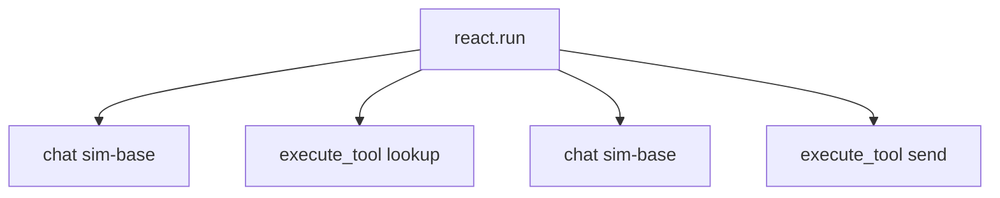
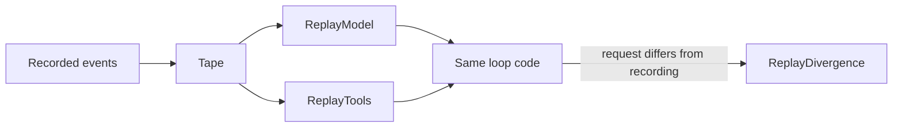

<!-- Generated by scripts/build_catalog.py. Edit patterns/tracing-replay/pattern.toml instead. -->

# Execution tracing, observability and replay

> Recording what an agent did well enough to explain it and to run it again.

## Problem

Agent runs are long, branching and non-deterministic. When one goes wrong you need to know what the model saw, what it did and how long each part took, and ideally to re-run the exact sequence against changed code. Different consumers want different shapes: a log to grep, a span tree for a tracing backend, and a tape to replay.

**Practical applications**

- Debugging failed runs
- Cost and latency attribution
- Regression tests built from recorded production runs

## Recommendation

_This section is advice. The evidence behind it is under [Measured comparison](#measured-comparison)._

Emit one structured event stream from the single place where models and tools are called, then derive the other views from it. Do not instrument each architecture separately.

## Solutions at a glance

| Solution | Status | Implementation | Example | Tests |
|---|---|---|---|---|
| [Flat event log](#flat-event-log) | implemented | [`src/agentlab/core/trace.py`](../../src/agentlab/core/trace.py) | [`examples/11_trace_and_replay.py`](../../examples/11_trace_and_replay.py) | [`tests/test_tracing.py`](../../tests/test_tracing.py) |
| [Span tree (OpenTelemetry-shaped)](#span-tree-opentelemetry-shaped) | implemented | [`src/agentlab/core/trace.py`](../../src/agentlab/core/trace.py) | [`examples/11_trace_and_replay.py`](../../examples/11_trace_and_replay.py) | [`tests/test_tracing.py`](../../tests/test_tracing.py) |
| [Record/replay tape](#recordreplay-tape) | implemented | [`src/agentlab/core/trace.py`](../../src/agentlab/core/trace.py) | [`examples/11_trace_and_replay.py`](../../examples/11_trace_and_replay.py) | [`tests/test_tracing.py`](../../tests/test_tracing.py) |

## Flat event log

**Status:** implemented

Append one JSON object per model call, tool result, message and state transition.

**Advantages**

- Simple, greppable, diffable
- The system of record for the other two views

**Limitations**

- No hierarchy or durations without post-processing
- Payloads are large

**Performance.** Measured: 36 events and 17.4k bytes per ReAct run of 15 steps.

**Use when**

- Always

**Avoid when**

- Never; restrict payloads if they hold sensitive data

**Integration**

```python
from agentlab.core.trace import Tracer
tracer = Tracer(clock)
rt = Runtime(model, tools, clock=clock, tracer=tracer)
...
tracer.write_jsonl("run.jsonl")
```

**Where you have seen it.** Structured logging; LangSmith runs; OpenAI Agents SDK trace events.

## Span tree (OpenTelemetry-shaped)

**Status:** implemented

Fold events into parent/child spans with start, end, status and GenAI attribute names.



**Advantages**

- Plugs into existing tracing backends
- Shows where time and tokens went

**Limitations**

- GenAI semantic conventions are still in development and may change
- Sampling can drop the run you need

**Performance.** Measured: 35 spans, 11.0k bytes per run.

**Use when**

- You already operate a tracing backend

**Avoid when**

- As the only record; spans are a lossy projection

**Integration**

```python
from agentlab.core.trace import build_spans
spans = build_spans(tracer.events)     # dicts with trace_id, span_id, parent_span_id, attributes
```
Map these onto your OpenTelemetry SDK's span API to export them.

**Where you have seen it.** OpenTelemetry GenAI semantic conventions; Agents SDK trace processors.

## Record/replay tape

**Status:** implemented

Serve recorded model responses and tool results back to the same code, checking that each request matches the recording.



**Advantages**

- Deterministic reproduction with no model or backend
- Turns a production run into a regression test
- Detects behavioural change in the loop

**Limitations**

- Only replays the recorded path; cannot answer what-if questions that change a request
- Requires deterministic loop code

**Reliability.** Measured: replay reproduced the full event stream, including timestamps, in 100% of recorded runs for every loop.

**Use when**

- Debugging
- Regression suites
- Cost-free CI for agent code

**Avoid when**

- Evaluating a prompt or model change (the recording no longer applies)

**Integration**

```python
from agentlab.core.trace import Tape, ReplayModel, ReplayTools, read_jsonl
tape = Tape(read_jsonl("run.jsonl"))
rt = Runtime(ReplayModel(tape), ReplayTools(tape, specs, clock), clock=clock)
ReActLoop(rt).run(goal)
```

**Where you have seen it.** VCR-style HTTP recording; Temporal replay; LangGraph time travel.

## Measured comparison

From [`experiments/results/tracing.json`](../../experiments/results/tracing.json), produced by `python -m experiments.run_all`. **Question:** What does it cost to record a run, and can a recorded run be replayed exactly?

**15-step tasks, 8% slips, 1 relocated key**

| Loop | Events | Event log bytes | Spans | Span tree bytes | Replay identical |
|---|---:|---:|---:|---:|---:|
| react | 36.36 | 17,420 | 35.36 | 10,958 | 100% |
| plan_execute | 22.36 | 14,984 | 21.36 | 6,009 | 100% |
| verified_graph | 74.52 | 24,247 | 27.62 | 8,166 | 100% |

**Measured findings**

- A flat event log costs 17420 bytes per ReAct run (36 events); the derived span tree is 10958 bytes (35 spans).
- Replay from the recorded tape reproduced the complete event stream (payloads and timestamps) exactly in 100% of runs at worst, across all three loops, with zero backend calls.
- The trace is dominated by model-call payloads; plan-and-execute traces are smallest because they contain the fewest model calls (14984 bytes vs 17420).

**Limitations of this experiment**

- Events store full model responses but only a fingerprint of each request; reconstructing prompts requires replaying.
- Span timing uses the simulated clock.

## Research

- OpenTelemetry (2026). [OpenTelemetry semantic conventions for GenAI agent and framework spans](https://github.com/open-telemetry/semantic-conventions-genai/blob/main/docs/gen-ai/gen-ai-agent-spans.md).
- OpenAI (2026). [OpenAI Agents SDK: Tracing](https://openai.github.io/openai-agents-python/tracing/).
- LangChain (2026). [LangGraph persistence (checkpointers and stores)](https://docs.langchain.com/oss/python/langgraph/persistence).
- Temporal Technologies (2026). [Temporal: Workflow Execution](https://docs.temporal.io/workflow-execution).
